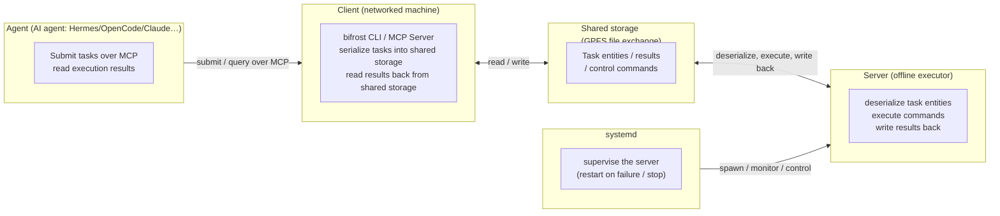
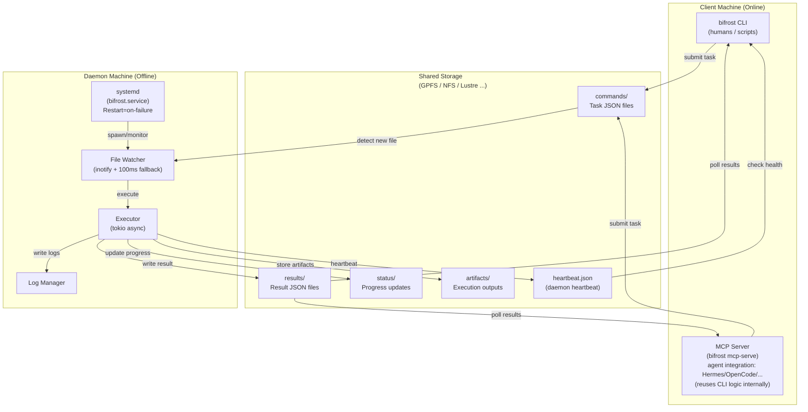
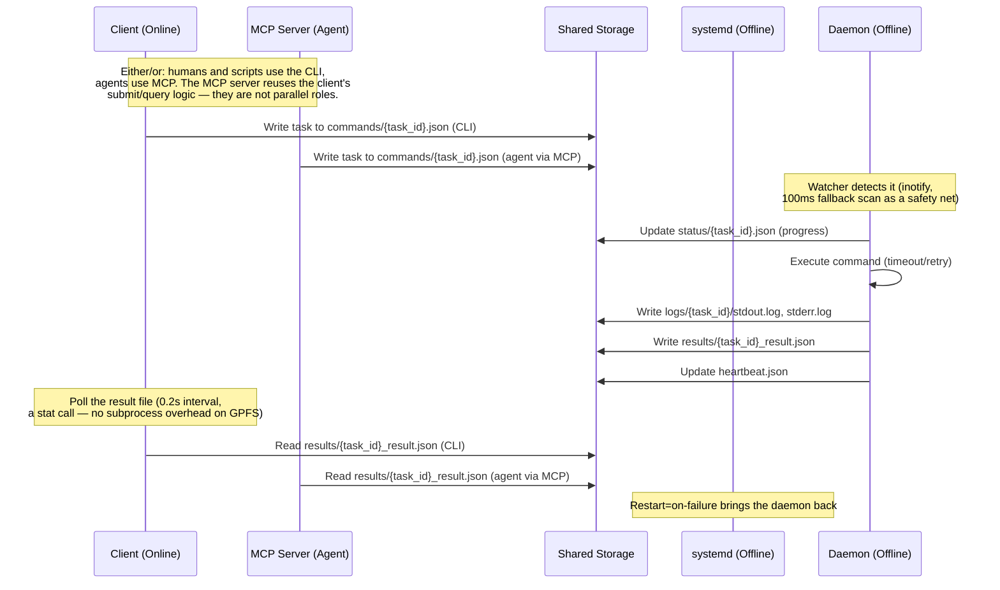

# 🌉 Bifrost — Command Execution Framework for Offline Machines


<p align="center">
  
</p>

**English** | [简体中文](README.zh-CN.md)

Bifrost is a Rust framework for executing commands on offline / air-gapped machines through shared storage. A networked client machine submits tasks; an offline daemon machine executes them; results are synchronized back through the same portable storage.

## Table of Contents

- [Overview](#overview)
  - [Problem Solved](#problem-solved)
  - [Key Features](#key-features)
- [Architecture](#architecture)
  - [Simplified (four components)](#simplified-four-components)
  - [Detailed (with shared storage and internals)](#detailed-with-shared-storage-and-internals)
- [Workflow](#workflow)
- [Directory Structure](#directory-structure)
- [Environment Requirements](#environment-requirements)
  - [Client Machine (online)](#client-machine-online)
  - [Daemon Machine (offline)](#daemon-machine-offline)
  - [Container Execution (Optional)](#container-execution-optional)
- [Installation](#installation)
  - [Build](#build)
  - [Deploy to the Client Machine (online)](#deploy-to-the-client-machine-online)
  - [Deploy to the Daemon Machine (offline)](#deploy-to-the-daemon-machine-offline)
  - [End-to-end Verification](#end-to-end-verification)
- [Configuration](#configuration)
  - [Settings File](#settings-file)
  - [daemon.* in detail](#daemon-in-detail)
  - [Clock self-check and fallback scanning](#clock-self-check-and-fallback-scanning)
  - [SSH Bridge](#ssh-bridge)
- [Usage](#usage)
  - [Shared storage and the pre-flight check](#shared-storage-and-the-pre-flight-check)
  - [Submit Tasks](#submit-tasks)
  - [Stopping the service](#stopping-the-service)
  - [Check Status](#check-status)
  - [Cancel Task](#cancel-task)
  - [Clean Up Old Tasks](#clean-up-old-tasks)
  - [Pytest in a Container](#pytest-in-a-container)
  - [Pytest Prerequisites](#pytest-prerequisites)
- [Release and Update](#release-and-update)
- [MCP Server (Agent Integration)](#mcp-server-agent-integration)
  - [Quick Start](#quick-start)
  - [Agent Configurations](#agent-configurations)
  - [MCP Tools](#mcp-tools)
  - [Standard Call Sequence](#standard-call-sequence)
  - [Verification](#verification)
  - [MCP Troubleshooting](#mcp-troubleshooting)
- [Task Types](#task-types)
- [Task Priority](#task-priority)
- [Security Features](#security-features)
- [Development](#development)
- [Documentation](#documentation)
- [Troubleshooting](#troubleshooting)
- [License](#license)
- [Status](#status)

---

## Overview

### Problem Solved

Traditional remote execution tools — SSH, RPC, REST APIs — do not work on air-gapped machines that have no network access. Bifrost uses **shared storage as the communication channel**:

- The **client** (networked machine) writes tasks into the `commands/` directory
- The **daemon** (offline machine) watches for new tasks and executes them
- **Results** are written back into the `results/` directory
- Synchronization happens over GPFS / NFS / Lustre or any other shared POSIX filesystem

### Key Features

- **Bridge abstraction** — transport-agnostic communication: shared storage (GPFS/NFS) **and SSH** are both implemented
- **Unified settings** — `~/.bifrost/settings.json`, initialized from the CLI
- **Air-gapped operation** — complete separation between client and server
- **Security hardened** — command injection prevention, path traversal protection
- **High performance** — inotify file watching plus a fallback scan (100ms), tokio async execution, end-to-end overhead ~4–6%
- **Multiple task types** — shell commands, pytest runs, custom adapters
- **Parallel jobs** — `--parallel` submits all tasks concurrently (bounded by the daemon's `max_concurrent`)
- **Priority scheduling** — tasks are sorted by priority (0–255)
- **Timeout management** — configurable timeouts with optional retry
- **systemd integration** — production-ready server deployment
- **systemd supervision** — `Restart=on-failure`, readiness reported via sd_notify, starts on boot
- **MCP Server** — built in, so any MCP-capable agent (Hermes / OpenCode / Claude) can drive it directly
- **Health monitoring** — heartbeat-based server health checks

## Architecture

### Simplified (four components)



### Detailed (with shared storage and internals)



## Workflow



## Directory Structure

```
/shared/storage/
├── commands/              # Client writes, daemon reads
│   └── 20260704_103000_{uuid}.json
├── results/               # Daemon writes, client reads
│   └── {uuid}_result.json
├── status/                # Daemon writes progress updates
│   └── {uuid}.json
├── artifacts/             # Execution artifacts
│   └── {uuid}_report.json
├── logs/                  # Detailed execution logs
│   └── {uuid}/
│       ├── stdout.log
│       ├── stderr.log
│       └── metadata.json
├── heartbeat.json         # Daemon health status
└── .processing/           # In-flight claim markers (stale ones are reclaimed)
```

## Environment Requirements

### Client Machine (online)

| Requirement | Version | Notes |
|------|------|------|
| **Rust** | 1.70+ | Build environment; only needed once |
| **Shared storage** | - | GPFS / NFS / Lustre or any POSIX shared filesystem, the same one the daemon uses |

### Daemon Machine (offline)

| Requirement | Version | Notes |
|------|------|------|
| **bifrost binary** | - | Single binary, no runtime dependencies |
| **systemd** | - | Optional, recommended for production |
| **Shared storage** | - | Same shared directory as the client (GPFS / NFS / Lustre …) |
| **Python** | 3.10+ | Optional, required for pytest tasks |
| **pytest** | 7.x | Optional, required for pytest tasks |
| **pytest-json-report** | - | Plugin for structured results |

### Container Execution (Optional)

Run pytest on the daemon machine inside a container:

```yaml
# adapters/docker_pytest.yaml
name: docker_pytest
description: Execute pytest in Docker container
command_template: "docker run --rm -v {working_dir}:/work python:3.10 pytest /work/{path} --json-report"
timeout: 600
artifacts:
  - report.json
env_vars:
  PYTEST_JSON_REPORT_FILE: "/work/report.json"
```

## Installation

Deployment is scripted — two commands, one per machine. The scripts live under
`scripts/{build,deploy,validate,ops,examples}/`; the manual steps below are exactly what they do,
so you only need them when you want to understand or deviate from the automation.

```bash
# target machine (daemon side, root)
sudo scripts/deploy/deploy-server.sh --storage /data/liuxin/bifrost

# online machine (client side)
scripts/deploy/deploy-client.sh --storage /data/liuxin/bifrost
```

### Build

The one-step path is `scripts/build/build.sh` (add `--static` for the musl artifact that the daemon
needs, `--dist` to drop a copy in `dist/`). The manual commands below are what it wraps.

> The build output location can be changed by `CARGO_TARGET_DIR` or a `target-dir` setting.
> Scripts must resolve the real path through `scripts/build/find-binary.sh [release|debug]` instead of
> hardcoding `target/release/bifrost`: it asks cargo to report the artifact
> (`--message-format=json`). `scripts/build/build.sh` and the deploy scripts already do this.

Building requires Rust 1.70+. Without a Rust toolchain you can build on any machine that has one and ship the single binary (statically linked, no runtime dependencies).

```bash
# Clone the repository
git clone https://github.com/peterlau123/bifrost.git
cd bifrost

# Build the release binary (~8MB single binary)
cargo build --release

# Verify the artifact
ls -lh target/release/bifrost
```

> **Cross-compilation:** if the target architecture differs (e.g. build on x86_64, deploy on aarch64):
> `cargo build --release --target aarch64-unknown-linux-gnu`

---

### Deploy to the Client Machine (online)

The client machine issues commands and queries results; it only needs the CLI binary and a settings file.

Scripted: `scripts/deploy/deploy-client.sh --storage <shared-dir>` installs the binary, runs
`bifrost client init` and reports whether the daemon is already alive
(`--binary --config --prefix --skip-build --force` optional).

```bash
# 1. Copy the binary
sudo cp target/release/bifrost /usr/local/bin/

# 2. Initialize the client-side settings (writes ~/.bifrost/settings.json)
bifrost client init --storage /mnt/gpfs/bifrost

# 3. Edit it and point shared_storage at the shared directory
vim ~/.bifrost/settings.json
```

```json
{
  "shared_storage": "/mnt/gpfs/bifrost",
  "client": {
    "poll_interval": "2s",
    "heartbeat_timeout": "180s"
  }
}
```

**Verify the client:**

```bash
# Show help
bifrost client submit --help

# Submit a trivial task to verify connectivity (the daemon must already be running)
bifrost client submit --command "hostname" --timeout 30
# Note the returned TASK_ID
bifrost client status <TASK_ID>
```

---

### Deploy to the Daemon Machine (offline)

The daemon machine is network-isolated: it receives commands and returns results through shared storage.

Both machines mount the same shared directory (GPFS today; NFS, Lustre and other POSIX filesystems also work), so the compiled binary can be picked up directly on the daemon side.

**Scripted (recommended):** `sudo scripts/deploy/deploy-server.sh --storage <shared-dir>` runs, in order:
candidate-binary gates (static link → `--version` → `warmup`) → `bifrost server init` → install + restart
(systemd, or `--no-systemd`) → wait for a fresh heartbeat → run one real task as a smoke test, rolling
back on failure. Optional flags: `--binary --config --prefix --service-name --gpus --skip-build
--skip-warmup --skip-smoke --allow-dynamic --force --log`.

```bash
# ---- Client side: write the build into the shared directory ----
cp target/release/bifrost /mnt/gpfs/bifrost/bin/

# ---- Daemon side: install from shared storage ----
# GPFS is mounted at /mnt/gpfs, so it can be read directly
sudo cp /mnt/gpfs/bifrost/bin/bifrost /usr/local/bin/
sudo chmod +x /usr/local/bin/bifrost

# Initialize the daemon-side settings
bifrost server init --storage /mnt/gpfs/bifrost
```

#### Configure shared storage on the daemon

```bash
vim ~/.bifrost/settings.json
```

```json
{
  "shared_storage": "/mnt/gpfs/bifrost",
  "daemon": {
    "poll_interval": "500ms",
    "task_timeout": "300s",
    "max_retries": 3,
    "heartbeat_interval": "60s",
    "max_concurrent": 10,
    "working_dir": "/tmp/bifrost/work"
  }
}
```

> **Important:** `shared_storage` must resolve to the same physical directory on the client and on the daemon.

#### Pre-flight self-check (every deployment, any filesystem)

`bifrost warmup` is a required step before the daemon goes live — it does not matter whether the
shared directory is GPFS, NFS, or a plain local path. It checks that the storage is writable, reports
the filesystem type, probes the clock, reads the existing heartbeat and lists the visible GPUs; it
exits 1 on blocking findings, so it can gate a deploy script.

```bash
bifrost warmup --storage /mnt/gpfs/bifrost
```

#### Register the systemd service (recommended for production)

```bash
# Install the unit file (bifrost.service ships in the project root)
sudo cp bifrost.service /etc/systemd/system/
sudo systemctl daemon-reload
sudo systemctl enable bifrost
sudo systemctl start bifrost

# Check status
sudo systemctl status bifrost

# Follow logs
journalctl -u bifrost -f
```

> For a shared-storage layout (e.g. H200's `/data/...`) the bundled unit does not fit — use
> `scripts/deploy/install-systemd.sh --storage <dir>` to render one for the actual layout, then
> `scripts/deploy/deploy-h200.sh` to install and restart. See [docs/deployment.md](docs/deployment.md).

#### Run the daemon manually (debugging)

```bash
# Foreground; stop with Ctrl+C
bifrost server

# With an explicit settings file
bifrost server --config ~/.bifrost/settings.json

# Verify the heartbeat file was created
ls -la /mnt/gpfs/bifrost/heartbeat.json
```

---

### End-to-end Verification

```bash
# Daemon side: confirm the daemon is up and the heartbeat is fresh
ls -la /mnt/gpfs/bifrost/heartbeat.json           # should exist and be updated within 60s
cat /mnt/gpfs/bifrost/heartbeat.json | head -5    # shows daemon state

# Client side: end-to-end test
# Note: commands are not interpreted by a shell (injection prevention), so && / | / > need sh -c
bifrost client submit \
  --command "sh -c 'echo \"bifrost deployment ok\"; nvidia-smi -L | head -3'" \
  --timeout 30

# Query the result after 5-10 seconds
bifrost client status <TASK_ID>
# Expected: "Completed", with output containing "bifrost deployment ok"
```
## Configuration

### Settings File

`~/.bifrost/settings.json`:

```bash
bifrost server init --storage /mnt/gpfs/bifrost  # generate daemon-side settings
```

```json
{
  "shared_storage": "/tmp/bifrost",
  "client": {},
  "daemon": {}
}
```

| Field | Client | Server | Description |
|-------|--------|--------|-------------|
| shared_storage | Yes | Yes | Root directory for commands/results/logs |
| transport | Yes | -- | Bridge type: `"shared"` (default) or `"ssh"` |
| ssh | Yes | -- | SSH bridge config (host/remote_dir/...) — required when transport=ssh |
| client.* | Yes | -- | Poll interval, heartbeat timeout, wait timeout (12h cap) |
| daemon.* | -- | Yes | Concurrency, timeout, retry, working dir |

#### daemon.* in detail

```json
{
  "shared_storage": "/data/liuxin/bifrost",
  "client": { "poll_interval": "5s" },
  "daemon": {
    "task_timeout": "1h30m",
    "max_concurrent": 8,
    "use_shell": true,
    "scan_interval": "1s",
    "stale_marker_timeout": "3h",
    "max_retries": 3,
    "gpu_pool": [0, 1, 2, 3, 4, 5, 6, 7],
    "working_dir": "/workspace/work"
  }
}
```

| Field | Default | Description |
|-------|---------|-------------|
| task_timeout | 1h30m | Default timeout when a task does not specify one. **No longer a cap**: a task's own `timeout` wins |
| max_concurrent | 10 | Number of tasks executed concurrently (1–100) |
| use_shell | true | Commands run through `sh -c`, so pipes, redirection, `&&`, `$VAR`, `&` all work; set false to exec argv directly. A single task can override with `shell: false` (use it for tasks containing literal `$` / `*`) |
| scan_interval | 1s | Fallback scan period in addition to inotify. An idle daemon no longer busy-polls and burns CPU; the scan thread writes `scan.json` (ticks/scanned_at) every second, so you can tell whether the fallback scan is still alive |
| stale_marker_timeout | 2×task_timeout | A `.processing` claim marker older than this is reclaimed. Ownership is verified before reclaiming: the marker records host/pid/task, and tasks owned by a live local process or by this process are skipped. Keepalive uses `min(60s, value/3)` |
| max_retries | unlimited | Upper bound on retries (unset = no bound). Retrying itself is opt-in per task: `client submit --retries 2` or YAML `retries: 2`; without it a task runs once. Only non-zero exits are retried — timeouts and cancellations are not. Each attempt is logged separately as `stdout.attemptN.log` |
| gpu_pool | **auto** | **Unset = automatically use every GPU on the machine** (detected via `nvidia-smi`). Each task gets an exclusive card injected as `CUDA_VISIBLE_DEVICES` (if the task names one itself, that id is leased but the value is not overwritten); the concurrency cap becomes `min(max_concurrent, #GPUs)`. `[]` disables GPU assignment, `[0,1]` uses only those two |
| cancel_poll | 1s | How often a running task checks for a cancel request. 1s balances cancellability against metadata overhead; 30s would mean a runaway benchmark keeps burning the GPU for half a minute before it dies |
| log_backups | 1 | Number of rotated backups to keep (`.1`..`.N`, max 9). Each stream rotates at a fixed 64MB, so disk usage is bounded by `64MB × (log_backups+1)`; the newest content is always in `stdout.log` |
| — | fixed | Result payload cap 64MB (16MB head context + 48MB tail summary) — benchmark summaries sit at the tail of the stream, so the tail is weighted more heavily; full logs live in `logs/<id>/` |

**Timeout semantics:** `client submit --timeout 0` (the default) means "use the daemon's `task_timeout`"; passing a concrete number makes the task's own value authoritative — the daemon no longer clamps it.

**Client-side cap:** `client.wait_timeout` (default 12h) is the hard upper bound on how long the client waits for a single job, so a dead daemon cannot block the client forever.

### Clock self-check and fallback scanning

Some virtualised environments (observed on H20) freeze `CLOCK_MONOTONIC`: `sleep()` deadlines never arrive, threads hang forever, and the daemon looks like "heartbeat fine but tasks never consumed". Newer machines such as H200 almost certainly do not have this defect, so **the default does not make every machine pay for it**:

| scan_mode | Behaviour |
|---|---|
| `auto` (default) | Spend ~200ms at startup comparing wall clock against the monotonic clock; switch to spin only when the two are confirmed to diverge |
| `sleep` | Force timer-driven scanning (lowest CPU), for machines known to be healthy |
| `spin` | Force busy-poll (~1 core), only for machines that really have a clock problem |

The self-check result is printed in the startup log: `clock: ok (sleep-driven scan)` or `WARNING: ... busy-poll`. If you still suspect a stall at runtime, use the external watchdog `scripts/ops/watchdog.sh` (reads the age of `heartbeat.json` / `scan.json` and restarts past a threshold) — it runs from cron or a systemd timer, so it does not share a failure domain with the daemon.

### SSH Bridge

When the client and the target machine have **no shared filesystem** but are reachable over SSH, use SSH as the transport: the client reads and writes the target's `commands/ results/ status/ artifacts/` directories over ssh, and the daemon on the target keeps consuming tasks through the local Protocol — both sides keep identical directory semantics, so the daemon needs no changes.

```json
{
  "shared_storage": "/tmp/bifrost",            // the daemon still uses this for its local paths
  "transport": "ssh",
  "ssh": {
    "host": "target-machine.example.com",      // required
    "user": "bifrost",                          // optional, defaults to the current user
    "remote_dir": "/gpfs/bifrost",              // required: the directory acting as shared_storage on the target
    "port": 22,                                 // optional, default 22
    "connect_timeout": "10s"                    // optional, per-connection timeout (default 10s)
  },
  "client": {},
  "daemon": {}
}
```

Requirements: passwordless `ssh <host>` from the client (`BatchMode=yes`). File contents travel over ssh stdin (`cat >` plus an atomic `mv`), and paths are shell-escaped, so there is no injection risk.

## Usage

### Shared storage and the pre-flight check

Bifrost only requires **a POSIX directory both sides can read and write**; it is not tied to GPFS, and
the same directory may be a network mount on one machine and a local path on the other. A typical H200
setup:

```bash
# ---- on the H200 (server side) ----
cd /data/liuxin/Ax/bifrost
scripts/build/build.sh --static                # artifact: dist/bifrost-linux-x86_64 (musl)
bifrost warmup  --storage /data/liuxin/bifrost # required: storage / clock / GPU self-check
bifrost server  --storage /data/liuxin/bifrost      # GPU pool auto-detects every card on the machine
# Limit the cards with --gpus 0,3,5; disable GPUs entirely with --gpus "" or "gpu_pool": []

# ---- on the client side (any machine that can see the same directory) ----
bifrost client submit --storage /data/liuxin/bifrost --command 'nvidia-smi -L'
```

- `--storage` and `--gpus` are **global flags** that override `shared_storage` and `daemon.gpu_pool` respectively, and work with any subcommand
- The GPU pool is auto-detected by default; `--gpus` is only for "limit the range" or "disable" (`--gpus ""`)
- The repo ships two prebuilt binaries (`dist/`, git-ignored): `bifrost-linux-x86_64` is **musl static** and
  runs on any x86_64 Linux; the `-glibc` variant requires glibc ≥ 2.39. Use the static one when you are unsure of the target OS
- On first run `commands/ results/ status/ artifacts/ logs/ cancel/` are created automatically, along with `heartbeat.json` / `scan.json`
- If the directory is a network filesystem shared by several machines, inotify may drop events — the fallback scan (1s by default) covers it, so GPFS is not required

#### Pre-flight check: `bifrost warmup`

**Step one of every deployment, whatever the filesystem is** — GPFS, NFS, Lustre or a plain local
directory all go through it. Run it on the machine that will host the daemon, before the first start:

```bash
bifrost warmup --storage /data/liuxin/bifrost   # or: bifrost --warmup
```

It checks shared-storage writability and filesystem type, performs the clock self-check (whether
`sleep()` can hang), reads the existing daemon heartbeat and reports GPU visibility. It exits 1 on
blocking findings, so it can gate a deploy script — which is exactly what
`scripts/deploy/deploy-server.sh` does. The systemd unit also runs it on every start (`ExecStartPost`),
but doing it once by hand catches a bad path or a frozen clock before anything is replaced.

**Why it has to run on the server side:** every check is a property of the executing side — a frozen clock
affects the daemon's fallback scan thread, the GPUs only exist on the target machine, and writability
depends on the daemon user's permissions. Running it on the client only proves "the shared directory is
writable from the client's point of view", which tells you nothing when the daemon fails to start
(different user, different machine).

### Submit Tasks

```bash
# Submit an arbitrary shell command (commands starting with pytest are treated as pytest tasks)
bifrost client submit --command "pytest tests/unit/ -v" --timeout 600
bifrost client submit --command "..." --timeout 0        # 0 = use the daemon default
bifrost client submit --command "..." --retries 2        # retry must be enabled explicitly (default 0)
bifrost client submit --command "python script.py --input data.csv" --timeout 300 --priority 10

# With an explicit working directory
bifrost client submit --command "make build" --working-dir /workspace/project --timeout 1200

# Submit a YAML job (multi-step, sequential)
bifrost client submit --job examples/quick_start.yaml
```

### Stopping the service

- `Ctrl+C` (SIGINT): graceful shutdown, **exits within 500ms**; a second `Ctrl+C` forces an immediate exit (exit 130)
- `SIGTERM` (`systemctl stop` / `kill`): also a graceful shutdown
- On exit it **SIGKILLs the process group of every running task**, so benchmarks cannot survive as orphans still holding the GPUs

### Check Status

```bash
# Query a task's status (positional argument, no --task-id)
bifrost client status <TASK_ID>

# Output
Task ID: abc123-def456
Status: Completed
Message: Task completed in 45s
```

### Cancel Task

```bash
bifrost client cancel <TASK_ID>
```

How it works: the client writes `cancel/<task_id>.json` into shared storage; for a **running** task the daemon polls that file every 300ms and, on a hit, `SIGKILL`s the whole process group (including grandchildren under `sh -c`), leaving the result in state `Cancelled`. A **queued** task is marked `Cancelled` right after being claimed, before execution starts. The cancel file is cleaned up once the task finishes. The MCP equivalent is `bifrost_cancel`.

### Clean Up Old Tasks

Long-running deployments accumulate files in `commands/ results/ status/ logs/ artifacts/`. `clean` removes all files of **finished tasks** (those with a result file) older than N days:

```bash
# Preview what would be removed (safe, no deletion)
bifrost client clean --older-than 7 --dry-run

# Actually remove finished tasks' files older than 7 days
bifrost client clean --older-than 7

# Target a specific storage directory
bifrost client clean --storage /gpfs/gcsp/liuxin/bifrost_test --older-than 30
```

**Safety guarantees:**

- Only tasks **with a result file** (terminal state) are touched — pending/running tasks are never candidates
- `heartbeat.json` and `settings.json` are **never** removed
- `--dry-run` previews before any deletion; `--older-than` defaults to 7 days

**Example output:**

```
$ bifrost client clean --older-than 7 --dry-run
  would remove aaaaaaaa-aaaa-aaaa-aaaa-aaaaaaaaaaaa (5 files)
  would remove bbbbbbbb-bbbb-bbbb-bbbb-bbbbbbbbbbbb (2 files)
[dry-run] 2 finished tasks, 7 files would be removed (older than 7 days)

$ bifrost client clean --older-than 7
Removed 7 files from 2 finished tasks (older than 7 days)
```

### Pytest in a Container

To run pytest in a container on the offline machine:

1. **Create a Docker adapter**:

```yaml
# /etc/bifrost/adapters/docker_pytest.yaml
name: docker_pytest
command_template: "docker run --rm -v {working_dir}:/app -w /app python:3.10-slim pytest {path} --json-report --json-report-file=report.json"
timeout: 600
artifacts:
  - report.json
```

2. **Submit a task with the adapter**:

```bash
bifrost client submit \
  --command "docker run --rm -v /workspace/myproject:/app -w /app python:3.10-slim pytest tests/unit/ --json-report --json-report-file=report.json" \
  --working-dir /workspace/myproject \
  --timeout 600
```

### Pytest Prerequisites

Install on the offline machine (or inside the container):

```bash
pip install pytest pytest-json-report pytest-cov
```

---

## Release and Update

One binary serves four roles — Client CLI, Daemon Server, MCP Server, and (optionally) systemd acting as the
supervisor. Updating it is mostly about knowing which of them keeps running:

| Role | Runs on | Needs a restart after a new build? |
|---|---|---|
| Client CLI | online machine | No — every invocation re-execs the binary |
| MCP Server | online machine (agent side) | **Yes** — kill the old `mcp-serve` process; the agent will not do it for you (Hermes: `pkill -f "bifrost mcp-serve"`) |
| Daemon Server | offline / GPU machine | **Yes** — `scripts/deploy/deploy-server.sh` does install → restart → verify in one shot |
| systemd unit | offline / GPU machine | No — `install-systemd.sh` renders it, and `deploy-server.sh` calls it |

```bash
# build once (musl static is what the daemon needs)
scripts/build/build.sh --static --dist

# roll it out on the daemon machine (install + restart + heartbeat + smoke, rollback on failure)
sudo scripts/deploy/deploy-server.sh --storage /data/liuxin/bifrost
```

Release checklist:

```
1. ✅ Client CLI    - automatic (stateless)
2. ⚠️ MCP Server   - kill the old mcp-serve process
3. 🔄 Daemon       - scripts/deploy/deploy-server.sh --storage <dir>
4. ⏹️ systemd unit - handled by deploy-server.sh
```

## MCP Server (Agent Integration)

Bifrost ships a **built-in MCP (Model Context Protocol) server** that exposes task submission as structured tools over stdio. **Any MCP-capable agent** — Hermes, OpenCode, Claude Code, Cline, Cursor, Codex, or any generic coding agent — can connect and submit tasks to the offline daemon without writing file-exchange glue code.

```
┌─────────────────────────────────────────┐
│ Any MCP agent (Hermes/OpenCode/Claude…) │
│   └─ stdio MCP ── bifrost mcp-serve    │  ← networked side (client machine)
├─────────────────────────────────────────┤
│        shared storage (shared_storage)   │
│   commands/  results/  status/  logs/   │
├─────────────────────────────────────────┤
│        bifrost daemon (offline)          │
│   inotify watch → concurrent exec → write back │
└─────────────────────────────────────────┘
```

The MCP server is **stateless**: every tool call reads and writes shared storage directly. Multiple agents can connect simultaneously (one process instance per connection) without conflicts.

> The full integration guide, including every agent's config sample, is in [MCP.md](MCP.md).

### Quick Start

**1. Build the binary** (on the online/client machine):

```bash
cargo build --release        # target/release/bifrost (3.0M)
```

**2. Prepare a settings file** — point `shared_storage` at the same exchange directory the offline daemon uses:

```json
{
  "shared_storage": "/gpfs/gcsp/liuxin/bifrost",
  "client": { "poll_interval": "2s", "heartbeat_timeout": "180s" },
  "daemon": { "task_timeout": "300s", "heartbeat_interval": "60s", "max_concurrent": 10 }
}
```

**3. Register it in your agent** — the universal config is:

```
command: /path/to/target/release/bifrost
args:    ["mcp-serve"]
env:     BIFROST_CONFIG=/path/to/settings.json   (optional; falls back to ~/.bifrost/settings.json)
```

Config resolution order: **`BIFROST_CONFIG` env > `-c` flag > `~/.bifrost/settings.json` > defaults**.

### Agent Configurations

**Hermes**

```bash
hermes mcp add bifrost --command /path/to/target/release/bifrost --args mcp-serve
hermes mcp test bifrost
```

**OpenCode** — `opencode.json`:

```json
{
  "mcp": {
    "bifrost": {
      "type": "stdio",
      "command": "/path/to/target/release/bifrost",
      "args": ["mcp-serve"],
      "env": { "BIFROST_CONFIG": "/path/to/settings.json" }
    }
  }
}
```

**Claude Code**

```bash
claude mcp add bifrost --env BIFROST_CONFIG=/path/to/settings.json -- /path/to/target/release/bifrost mcp-serve
```

or project-level `.mcp.json`:

```json
{
  "mcpServers": {
    "bifrost": {
      "command": "/path/to/target/release/bifrost",
      "args": ["mcp-serve"],
      "env": { "BIFROST_CONFIG": "/path/to/settings.json" }
    }
  }
}
```

**Cline / Cursor / generic coding agents** — the same `mcpServers` JSON shape with `command` + `args` + `env` (see [MCP.md](MCP.md) for screenshot-level detail).

### MCP Tools

| Tool | Purpose | When to call |
|------|---------|-------------|
| `bifrost_health` | Check offline daemon heartbeat freshness | **Always before submit**: if `alive=false`, tasks would be written but never consumed (inotify only watches new files) |
| `bifrost_submit` | Submit a command task, returns `task_id` | Args: `command` (required), `timeout`, `priority`, `working_dir` |
| `bifrost_status` | Query task status | Poll with `task_id` until terminal state |
| `bifrost_result` | Fetch full result | After terminal state: stdout/stderr/exit_code/duration_ms |

### Standard Call Sequence

```
1. bifrost_health        → confirm alive=true (daemon online)
2. bifrost_submit        → {"command": "sh -c 'echo hi'", "timeout": 60} → task_id
3. bifrost_status        → poll: Pending → Running → Completed/Failed/Timeout
4. bifrost_result        → get stdout, exit code, duration
```

**Important rules:**

- Complex commands **must be wrapped in `sh -c '...'`** (injection-prevention design; `>`, `&&`, `$VAR`, `&` need a shell)
- Check `bifrost_health` before submitting — a not-ready daemon silently drops tasks
- The daemon executes concurrently up to `max_concurrent` (default 10); burst submits are fine

### Verification

```bash
# Via Hermes
hermes mcp test bifrost

# Manual JSON-RPC handshake (any agent-agnostic check)
echo '{"jsonrpc":"2.0","id":1,"method":"initialize","params":{"protocolVersion":"2025-06-18","capabilities":{},"clientInfo":{"name":"inspector","version":"1.0"}}}' \
  | bifrost mcp-serve | head -3

# Full E2E: health → submit → status → result
python3 /gpfs/gcsp/liuxin/bifrost_test/test_mcp_e2e.py
```

### MCP Troubleshooting

| Problem | Cause | Fix |
|---------|-------|-----|
| Connection closed on add | shared_storage path not writable/missing | Fix `shared_storage` in settings.json |
| `alive: false` | daemon not running or heartbeat stale | Start `bifrost server -c <cfg>` on the target machine, wait 2s |
| Task stuck Pending | daemon not consuming (inotify skips existing files) | Check health before submit; ensure the server is up |
| submit error | command format issue | Wrap complex commands in `sh -c '...'` |
| Multi-agent usage | — (no conflict, file-based) | No extra config needed |

## Task Types

| Type | Description | Use Case |
|------|-------------|----------|
| `shell` | Shell command execution | Build scripts, data processing |
| `pytest` | Python test execution | Unit tests, integration tests |
| `custom` | Adapter-based execution | Docker, specialised tools |

## Task Priority

Priority ranges from 0 to 255:

| Range | Priority | Example |
|-------|----------|---------|
| 0-10 | High | Critical fixes, urgent tests |
| 11-50 | Normal | Regular tests, builds |
| 51-100 | Low | Background tasks, cleanup |
| 101-255 | Lowest | Maintenance, logs |

## Security Features

### Command Injection Prevention

Bifrost uses `shell-words::split()` to parse commands safely, avoiding shell interpolation:

```rust
// Safe: Direct process spawn without shell
let args = shell_words::split(&command)?;
Command::new(&args[0]).args(&args[1..]);
```

> **Practical caveat:** because commands are not interpreted by a shell, **shell syntax such as `&&`, `||`, pipes `|`, redirection `>` and globs `*` does not take effect** — the whole string becomes arguments to a single executable. When you need shell features, wrap the command explicitly in `sh -c`:

```bash
# ✅ Correct: explicitly invoke a shell for multiple commands/pipes/redirection
bifrost client submit --command "sh -c 'cd /workspace && make build 2>&1 | tee build.log'"

# ❌ Wrong: && and | are passed to echo verbatim and never executed
bifrost client submit --command "echo hello && nvidia-smi -L | head -3"
```

### Task monitoring timing (inotify behaviour)

The daemon watches `commands/` with `notify` (inotify), which **only reports files created after startup** — existing tasks are not scanned. Therefore:

- **Correct order**: start the daemon first, then submit tasks
- **Leftover tasks**: a task file already in `commands/` before the daemon starts is never consumed (and no error is raised); resubmit it or handle it after a daemon restart

### Path Traversal Protection

Artifact paths are validated with canonicalization:

```rust
// Validate: no /, \, .., or null bytes
// Canonicalize: verify path is within artifacts directory
let canonical = artifact_path.canonicalize()?;
if !canonical.starts_with(&artifacts_dir) {
    return Err("Path traversal detected");
}
```

## Development

### Running Tests

```bash
# All tests (218 cases: 130 lib + 10 bin + 77 integration + 1 doctest)
cargo test --all

# Unit tests only
cargo test --lib

# Integration tests — tests/unit 与 tests/integration 下的文件必须在 Cargo.toml 里用 [[test]] 声明，
# cargo 不会自动递归子目录（漏声明 = 静默不编译）
cargo test --test full_workflow_test
cargo test --test coverage_boost_test

# End-to-end (same suite the pipeline runs)
cargo build --release && python3 tests/e2e/run_all.py ./target/release/bifrost

# Coverage (requires tarpaulin)
cargo tarpaulin --out Html
```

### End-to-End Tests (CI-equivalent)

The full e2e suite lives in `tests/e2e/` (timeout, job, concurrent, multi-GPU pytest, robustness, MCP) and runs in CI (`.github/workflows/ci.yml`):

```bash
cargo build --release
python3 tests/e2e/run_all.py ./target/release/bifrost   # 6 suites, ~50s
```

CI also enforces `cargo fmt --check` and `cargo clippy --all-targets -- -D warnings` on every push.

### Project Structure

```
bifrost/
├── src/
│   ├── core/           # Core models, protocol, and services
│   │   ├── models.rs   # Task, TaskResult, TaskStatus
│   │   ├── bridge.rs   # Bridge transport trait
│   │   ├── protocol.rs # Shared-storage bridge impl
│   │   ├── settings.rs # ~/.bifrost/settings.json
│   │   ├── sdnotify.rs # systemd readiness notification
│   │   ├── error.rs    # Error types
│   │   ├── lock.rs     # File locking
│   │   └── batch_tracker.rs
│   ├── client/         # Client submission and query
│   │   ├── submit.rs   # Task submission
│   │   ├── status.rs   # Status query
│   │   ├── results.rs  # Result retrieval
│   │   └── launcher.rs # Job launcher
│   ├── daemon/         # Daemon executor and watcher
│   │   ├── watcher.rs  # File event monitoring
│   │   ├── executor.rs # Command execution
│   │   ├── heartbeat.rs# Health monitoring
│   │   └── logger.rs   # Log management
│   └── main.rs         # CLI entry point
├── tests/
│   ├── unit/           # Unit tests
│   └── integration/    # Integration tests
├── config/             # Default configurations
├── scripts/            # Build / deploy / validation scripts
└── docs/               # Documentation
```

## Documentation

- [Adapter Guide](docs/adapter-guide.md) — custom task adapters
- [Deployment Guide](docs/deployment.md) — production deployment, systemd, container-build → host-install flow
- [Operations Practice](docs/ops-practice.md) — real-world operational notes
- [MCP Integration Guide](MCP.md) — universal agent integration (OpenCode / Claude Code / Cline / Cursor / Hermes)
- [Test Report](test.md) — performance, timeout and job-workflow test reports

## Troubleshooting

### Daemon Not Detecting Tasks

1. Check shared storage path permissions
2. Verify the notify library works: `strace -e inotify_wait bifrost server`
3. Check that the `commands/` directory exists
4. **The task was submitted before the daemon started** — inotify only watches files created *after* startup; stale tasks in `commands/` are silently ignored. Resubmit the task or restart the daemon.

### Task Timeout

1. Increase the timeout when submitting the task
2. Check system resources on the daemon machine
3. Profile how long the command actually takes

### Heartbeat Timeout

1. Verify the daemon process is running: `systemctl status bifrost`
2. Check `heartbeat.json` permissions
3. Verify the shared storage is accessible

### Artifact Not Found

1. Verify the command actually produces the declared artifacts
2. Check the working directory
3. Verify `artifact_name` contains no path separators

## License

MIT License — see the [LICENSE](LICENSE) file.

## Status

Bifrost v0.1.0 is released. Core functionality is stable and tested. Planned enhancements:

- Web UI monitoring dashboard
- Distributed execution (multiple daemons)
- Task dependency graph (DAG scheduling)
- AI-based task scheduling optimisation
