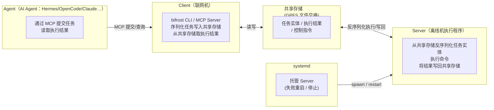
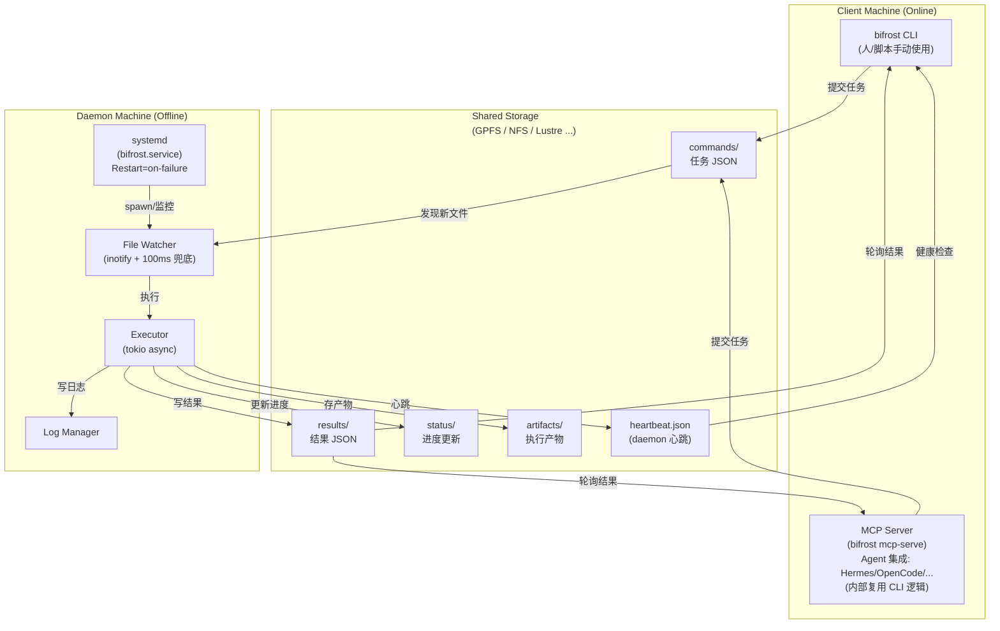
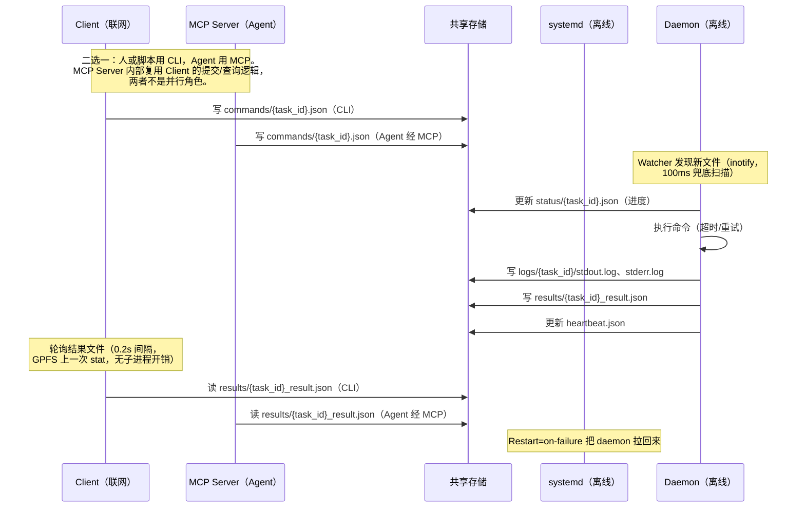

# 🌉 Bifrost —— 离线机器命令执行框架


<p align="center">
  
</p>

[English](README.md) | **简体中文**

Bifrost 是一个 Rust 框架，用**共享存储**作为通信通道，在离线/气隙（air-gapped）机器上执行命令。联网的 client 机器提交任务，离线的 daemon 机器执行任务，结果通过同一份共享存储回传。

## 目录

- [概览](#概览)
  - [解决什么问题](#解决什么问题)
  - [核心特性](#核心特性)
- [架构](#架构)
  - [简略图（四组件交互）](#简略图四组件交互)
  - [详细图（含共享存储与内部组件）](#详细图含共享存储与内部组件)
- [工作流](#工作流)
- [目录结构](#目录结构)
- [环境要求](#环境要求)
  - [源机器（联网，Client 端）](#源机器联网client-端)
  - [目标机器（离线，Daemon 端）](#目标机器离线daemon-端)
  - [容器内执行（可选）](#容器内执行可选)
- [安装](#安装)
  - [编译](#编译)
  - [部署到源机器（联网，Client 端）](#部署到源机器联网client-端)
  - [部署到目标机器（离线，Daemon 端）](#部署到目标机器离线daemon-端)
  - [端到端验证](#端到端验证)
- [配置](#配置)
  - [配置文件](#配置文件)
  - [daemon.* 详解](#daemon-详解)
  - [时钟自检与兜底扫描](#时钟自检与兜底扫描)
  - [SSH 传输层](#ssh-传输层)
- [使用](#使用)
  - [共享目录与上线自检](#共享目录与上线自检)
  - [提交任务](#提交任务)
  - [停止服务](#停止服务)
  - [查询状态](#查询状态)
  - [取消任务](#取消任务)
  - [清理历史任务](#清理历史任务)
  - [容器内跑 pytest](#容器内跑-pytest)
  - [pytest 依赖](#pytest-依赖)
- [发布与更新](#发布与更新)
- [MCP Server（Agent 接入）](#mcp-serveragent-接入)
  - [快速开始](#快速开始)
  - [各 Agent 配置](#各-agent-配置)
  - [MCP 工具](#mcp-工具)
  - [标准调用顺序](#标准调用顺序)
  - [验证](#验证)
  - [MCP 排障](#mcp-排障)
- [任务类型](#任务类型)
- [任务优先级](#任务优先级)
- [安全特性](#安全特性)
- [开发](#开发)
- [文档](#文档)
- [排障](#排障)
- [License](#license)
- [状态](#状态)

---

## 概览

### 解决什么问题

面对气隙机器（完全没有网络访问），SSH、RPC、REST API 这类传统远程执行手段都不可用。Bifrost 把**共享存储当作通信通道**：

- **Client**（联网机器）把任务写进 `commands/` 目录
- **Daemon**（离线机器）监听新任务并执行
- **结果**写回 `results/` 目录
- 同步通过 GPFS / NFS / Lustre 等任何共享 POSIX 文件系统完成

### 核心特性

- **传输层抽象（Bridge）**——不绑定具体传输方式：共享存储（GPFS/NFS）与 **SSH** 均已实现
- **统一配置**——`~/.bifrost/settings.json`，可通过 CLI 初始化
- **气隙环境可用**——client 与 server 完全隔离
- **安全加固**——防命令注入、防路径穿越
- **高性能**——inotify 监听 + 兜底扫描（100ms），tokio 异步执行，端到端开销约 4~6%
- **多种任务类型**——shell 命令、pytest、自定义 adapter
- **并行 job**——`--parallel` 并发提交所有子任务（受 daemon `max_concurrent` 限制）
- **优先级调度**——按优先级（0~255）排序执行
- **超时管理**——超时可配置，重试按需开启
- **systemd 集成**——可直接部署为生产服务
- **systemd 托管**——`Restart=on-failure` 崩溃自愈、sd_notify 就绪上报、开机自启
- **内置 MCP Server**——任何支持 MCP 的 Agent（Hermes / OpenCode / Claude）可直接接入
- **健康监控**——基于心跳的服务存活探测

## 架构

### 简略图（四组件交互）



### 详细图（含共享存储与内部组件）



## 工作流



## 目录结构

```
/shared/storage/
├── commands/              # Client 写入，daemon 读取
│   └── 20260704_103000_{uuid}.json
├── results/               # Daemon 写入，client 读取
│   └── {uuid}_result.json
├── status/                # Daemon 写入进度更新
│   └── {uuid}.json
├── artifacts/             # 执行产物
│   └── {uuid}_report.json
├── logs/                  # 详细执行日志
│   └── {uuid}/
│       ├── stdout.log
│       ├── stderr.log
│       └── metadata.json
├── heartbeat.json         # Daemon 健康状态
└── .processing/           # 抢占中任务的标记（过期的会被回收）
```

## 环境要求

### 源机器（联网，Client 端）

| 需求 | 版本 | 说明 |
|------|------|------|
| **Rust** | 1.70+ | 编译环境，只需编译一次 |
| **共享存储** | - | GPFS / NFS / Lustre 等 POSIX 共享文件系统，与目标机器共用 |

### 目标机器（离线，Daemon 端）

| 需求 | 版本 | 说明 |
|------|------|------|
| **bifrost 二进制** | - | 单一二进制，零运行时依赖 |
| **systemd** | - | 可选，推荐生产使用 |
| **共享存储** | - | 与源机器挂载同一共享目录（GPFS / NFS / Lustre 等） |
| **Python** | 3.10+ | 可选，执行 pytest 任务时需要 |
| **pytest** | 7.x | 可选，执行 pytest 任务时需要 |
| **pytest-json-report** | - | 输出结构化结果所需的 pytest 插件 |

### 容器内执行（可选）

在目标机器上通过容器执行 pytest：

```yaml
# adapters/docker_pytest.yaml
name: docker_pytest
description: Execute pytest in Docker container
command_template: "docker run --rm -v {working_dir}:/work python:3.10 pytest /work/{path} --json-report"
timeout: 600
artifacts:
  - report.json
env_vars:
  PYTEST_JSON_REPORT_FILE: "/work/report.json"
```

## 安装

部署是全脚本化的：两台机器各一条命令。脚本在 `scripts/{build,deploy,validate,ops,examples}/` 下，
下面的手工步骤就是它们做的事——只有想理解或改流程时才需要手敲。

```bash
# 目标机（daemon 侧，root）
sudo scripts/deploy/deploy-server.sh --storage /data/liuxin/bifrost

# 联网机（client 侧）
scripts/deploy/deploy-client.sh --storage /data/liuxin/bifrost
```

### 编译

一条命令走完：`scripts/build/build.sh`（部署到 daemon 侧要加 `--static` 产 musl，加 `--dist` 顺手复制到
`dist/`）。下面这些手工步骤就是它包起来的东西。

> 构建产物的位置可能被 `CARGO_TARGET_DIR` 或 `target-dir` 配置改掉。脚本请用
> `scripts/build/find-binary.sh [release|debug]` 取真实路径，不要写死 `target/release/bifrost`：
> 它让 cargo 自己报告产物（`--message-format=json`）。`scripts/build/build.sh` 与各部署脚本都是这样。

编译需要 Rust 1.70+。如果没有 Rust 工具链，可以在任意有 Rust 的机器上编译，然后分发单一二进制文件（静态编译，无运行时依赖）。

```bash
# 克隆仓库
git clone https://gitee.com/peterlau/bifrost.git
cd bifrost

# 编译 release 版本（约 8MB 单一二进制）
cargo build --release

# 确认编译产物
ls -lh target/release/bifrost
```

> **交叉编译：** 如果目标架构不同（如 x86_64 编译、aarch64 部署）：
> `cargo build --release --target aarch64-unknown-linux-gnu`

---

### 部署到源机器（联网，Client 端）

源机器负责下发命令和查询结果，只需要 CLI 二进制和配置文件。

脚本方式：`scripts/deploy/deploy-client.sh --storage <共享目录>` 会装二进制、跑 `bifrost client init`，
并顺带报一下 daemon 是否已经在线（可选 `--binary --config --prefix --skip-build --force`）。

```bash
# 1. 复制二进制
sudo cp target/release/bifrost /usr/local/bin/

# 2. 初始化 client 侧配置（生成 ~/.bifrost/settings.json）
bifrost client init --storage /mnt/gpfs/bifrost

# 3. 编辑配置，指定共享存储路径
vim ~/.bifrost/settings.json
```

```json
{
  "shared_storage": "/mnt/gpfs/bifrost",
  "client": {
    "poll_interval": "2s",
    "heartbeat_timeout": "180s"
  }
}
```

**验证 Client：**

```bash
# 查看帮助
bifrost client submit --help

# 提交一个简单任务验证连通性（需目标机器 daemon 已运行）
bifrost client submit --command "hostname" --timeout 30
# 记下返回的 TASK_ID
bifrost client status <TASK_ID>
```

---

### 部署到目标机器（离线，Daemon 端）

目标机器网络隔离，通过共享存储接收命令并返回结果。

两台机器挂载同一共享目录（当前使用 GPFS，也支持 NFS、Lustre 等 POSIX 文件系统），编译好的二进制可以直接被目标机器访问。

**脚本方式（推荐）**：`sudo scripts/deploy/deploy-server.sh --storage <共享目录>` 依次做：候选二进制门槛
（静态链接 → `--version` → `warmup`）→ `bifrost server init` → 安装并重启（systemd，或 `--no-systemd`）
→ 等心跳刷新 → 真跑一条任务做 smoke，失败自动回滚。可选参数：`--binary --config --prefix
--service-name --gpus --skip-build --skip-warmup --skip-smoke --allow-dynamic --force --log`。

```bash
# ---- 源机器端：编译后写入 GPFS 共享目录 ----
cp target/release/bifrost /mnt/gpfs/bifrost/bin/

# ---- 目标机器端：从共享存储安装 ----
# GPFS 已挂载在 /mnt/gpfs，直接访问
sudo cp /mnt/gpfs/bifrost/bin/bifrost /usr/local/bin/
sudo chmod +x /usr/local/bin/bifrost

# 初始化 daemon 侧配置
bifrost server init --storage /mnt/gpfs/bifrost
```

#### 目标机器配置 shared storage

```bash
vim ~/.bifrost/settings.json
```

```json
{
  "shared_storage": "/mnt/gpfs/bifrost",
  "daemon": {
    "poll_interval": "500ms",
    "task_timeout": "300s",
    "max_retries": 3,
    "heartbeat_interval": "60s",
    "max_concurrent": 10,
    "working_dir": "/tmp/bifrost/work"
  }
}
```

> **重要：** 源机器与目标机器的 `shared_storage` 必须指向同一物理目录。

#### 上线前自检（每次部署都要做，与文件系统无关）

`bifrost warmup` 是 daemon 上线前的必需步骤 —— 共享目录是 GPFS、NFS 还是本地目录都一样。
它检查存储可写性、打印文件系统类型、做时钟自检、读现有心跳、列出可见 GPU；有阻断项时退出码 1，
因此可以直接当作部署脚本的门槛。

```bash
bifrost warmup --storage /mnt/gpfs/bifrost
```

#### 注册 systemd 服务（推荐生产使用）

```bash
# 安装服务文件（项目根目录有 bifrost.service）
sudo cp bifrost.service /etc/systemd/system/
sudo systemctl daemon-reload
sudo systemctl enable bifrost
sudo systemctl start bifrost

# 查看状态
sudo systemctl status bifrost

# 查看实时日志
journalctl -u bifrost -f
```

> 共享盘布局（如 H200 的 `/data/...`）不适用仓库根目录那份 unit —— 用
> `scripts/deploy/install-systemd.sh --storage <dir>` 按实际布局渲染，再用
> `scripts/deploy/deploy-h200.sh` 安装并重启。详见 [docs/deployment.zh-CN.md](docs/deployment.zh-CN.md)。

#### 手动启动守护进程（调试用）

```bash
# 前台运行，按 Ctrl+C 停止
bifrost server

# 指定配置文件
bifrost server --config ~/.bifrost/settings.json

# 验证心跳文件已生成
ls -la /mnt/gpfs/bifrost/heartbeat.json
```

---

### 端到端验证

```bash
# 目标机器端：确认 daemon 运行且心跳正常
ls -la /mnt/gpfs/bifrost/heartbeat.json           # 文件应存在，60s 内更新
cat /mnt/gpfs/bifrost/heartbeat.json | head -5    # 显示 daemon 状态

# 源机器端：端到端测试
# 注意：命令不经 shell 解释（防注入），&& / | / > 等 shell 语法需用 sh -c 包裹
bifrost client submit \
  --command "sh -c 'echo \"bifrost deployment ok\"; nvidia-smi -L | head -3'" \
  --timeout 30

# 5-10 秒后查询结果
bifrost client status <TASK_ID>
# 预期输出为 "Completed"，消息包含 "bifrost deployment ok"
```
## 配置

### 配置文件

`~/.bifrost/settings.json`：

```bash
bifrost server init --storage /mnt/gpfs/bifrost  # 生成 daemon 侧配置
```

```json
{
  "shared_storage": "/tmp/bifrost",
  "client": {},
  "daemon": {}
}
```

| 字段 | Client | Server | 说明 |
|-------|--------|--------|-------------|
| shared_storage | 是 | 是 | commands/results/logs 的根目录 |
| transport | 是 | -- | 传输层：`"shared"`（默认）或 `"ssh"` |
| ssh | 是 | -- | SSH 传输配置（host/remote_dir/...），transport=ssh 时必填 |
| client.* | 是 | -- | 轮询间隔、心跳超时、等待上限（12h 上限） |
| daemon.* | -- | 是 | 并发、超时、重试、工作目录 |

#### daemon.* 详解

```json
{
  "shared_storage": "/data/liuxin/bifrost",
  "client": { "poll_interval": "5s" },
  "daemon": {
    "task_timeout": "1h30m",
    "max_concurrent": 8,
    "use_shell": true,
    "scan_interval": "1s",
    "stale_marker_timeout": "3h",
    "max_retries": 3,
    "gpu_pool": [0, 1, 2, 3, 4, 5, 6, 7],
    "working_dir": "/workspace/work"
  }
}
```

| 字段 | 默认值 | 说明 |
|-------|---------|-------------|
| task_timeout | 1h30m | 任务未指定 timeout 时的默认值。**不再作为上限**：任务自己写的 `timeout` 优先 |
| max_concurrent | 10 | 同时执行的任务数（1–100） |
| use_shell | true | 命令经 `sh -c` 执行，管道/重定向/`&&`/`$VAR`/`&` 均可用；设 false 退回 argv 直执行。单个任务可用 `shell: false` 覆盖（YAML 里给字面量 `$`/`*` 的任务用） |
| scan_interval | 1s | inotify 之外的兜底扫描周期。空闲 daemon 不再忙轮询占 CPU；扫描线程每秒写 `scan.json`（ticks/scanned_at），可据此判断兜底扫描是否还活着 |
| stale_marker_timeout | 2×task_timeout | `.processing` 抢占标记超过此年龄即回收。回收前校验归属：marker 内记录了 host/pid/task，本机存活进程或本进程正在跑的任务一律跳过；keepalive 自动取 `min(60s, 该值/3)` |
| max_retries | 不限制 | 任务重试次数的**上限**（不配 = 不设上限）。重试本身是任务侧 opt-in：`client submit --retries 2` 或 YAML `retries: 2`，不写就是跑一次。只对非零退出重试，超时/取消不重试；每次尝试日志单独保存为 `stdout.attemptN.log` |
| gpu_pool | **自动** | **不配置 = 自动使用本机全部 GPU**（`nvidia-smi` 探测）。每个任务独占一张卡并注入 `CUDA_VISIBLE_DEVICES`（任务自己指定则该 id 占租约，不覆盖值）；并发上限取 `min(max_concurrent, 卡数)`。`[]` = 关闭 GPU 分配，`[0,1]` = 只用这两张 |
| cancel_poll | 1s | 运行中任务检查 cancel 请求的间隔。1s 是可取消性与元数据开销的折中；30s 意味着跑飞的 benchmark 要空转半分钟才被杀 |
| log_backups | 1 | 保留几个轮转备份（`.1`..`.N`，上限 9）。单流日志固定 64MB 转一次，磁盘占用上界 ≈ `64MB × (log_backups+1)`；最新内容始终在 `stdout.log` |
| — | 固定 | 结果载荷上限 64MB（头 16MB 上下文 + 尾 48MB 汇总）——benchmark summary 在流尾，尾部权重更大；完整日志另存 `logs/<id>/` |

**超时语义**：`client submit --timeout 0`（默认）= 用 daemon 的 `task_timeout`；传具体秒数则任务自己的值生效，daemon 不再钳制。

**客户端上限**：`client.wait_timeout`（默认 12h）是客户端等待单个 job 任务的硬上限，防止 daemon 挂掉后 client 永远阻塞。

### 时钟自检与兜底扫描

某些虚拟化环境（H20 上记录过）会出现 `CLOCK_MONOTONIC` 冻结：`sleep()` 的 deadline 永不到达，线程永久卡住，daemon 表现为"心跳正常但不消费任务"。H200 等新机器大概率没有这个问题，所以**默认不背这个成本**：

| scan_mode | 行为 |
|---|---|
| `auto`（默认） | 启动时花 ~200ms 自检：同时看墙钟与单调时钟，只有确认二者脱节才切到 spin |
| `sleep` | 强制定时器驱动（最低 CPU），适合确认健康的机器 |
| `spin` | 强制 busy-poll（~1 核），只给确有时钟问题的机器 |

自检结果会打在启动日志里：`clock: ok (sleep-driven scan)` 或 `WARNING: ... busy-poll`。运行时若仍怀疑停摆，用外部看门狗 `scripts/ops/watchdog.sh`（读 `heartbeat.json` / `scan.json` 年龄，超阈值重启）——它跑在 cron/systemd timer 里，不和 daemon 共享故障域。

### SSH 传输层

当 client 与目标机**没有共享文件系统**、但可通过 SSH 访问时，用 SSH 作为传输层：client 通过 ssh 读写目标机的 `commands/ results/ status/ artifacts/` 目录，目标机上的 daemon 依旧用本地 Protocol 消费任务——两端目录语义完全一致，daemon 无需改动。

```json
{
  "shared_storage": "/tmp/bifrost",            // daemon 侧仍用它定位本地目录
  "transport": "ssh",
  "ssh": {
    "host": "target-machine.example.com",      // 必填
    "user": "bifrost",                          // 可选，默认当前用户
    "remote_dir": "/gpfs/bifrost",              // 必填：目标机上充当 shared_storage 的目录
    "port": 22,                                 // 可选，默认 22
    "connect_timeout": "10s"                    // 可选，每次 ssh 连接超时（默认 10s）
  },
  "client": {},
  "daemon": {}
}
```

要求：本机可 `ssh <host>` 免密登录（`BatchMode=yes`）。文件内容经 ssh stdin 传输（`cat >` + 原子 `mv`），路径经 shell 转义，无注入风险。

## 使用

### 共享目录与上线自检

bifrost 只要求**两端都能读写的 POSIX 目录**，不绑定 GPFS；同一个目录在两台机器上甚至可能是不同形态
（一边是网络挂载、一边是本地路径）。H200 上的典型用法：

```bash
# ── H200（server 端）───────────────────────────────────────
cd /data/liuxin/Ax/bifrost
scripts/build/build.sh --static                # 产物：dist/bifrost-linux-x86_64（musl 静态）
bifrost warmup  --storage /data/liuxin/bifrost # 必跑：存储可写/时钟/GPU 自检
bifrost server  --storage /data/liuxin/bifrost      # GPU 池自动探测本机全部卡
# 需要限制卡范围时：--gpus 0,3,5；完全不用 GPU：--gpus "" 或配置 "gpu_pool": []

# ── client 端（任何能看到同一目录的机器）──────────────────
bifrost client submit --storage /data/liuxin/bifrost --command 'nvidia-smi -L'
```

- `--storage` / `--gpus` 都是**全局参数**，分别覆盖 `shared_storage` 与 `daemon.gpu_pool`，任意子命令可用
- GPU 池默认自动探测；`--gpus` 只用于"限制范围"或"关闭"（`--gpus ""`）
- 仓库里带了两个预编译二进制（`dist/`，已 gitignore）：`bifrost-linux-x86_64` 是 **musl 静态**，
  任意 x86_64 Linux 直接跑；`-glibc` 那个要求 glibc ≥ 2.39。不确定对方系统版本时用静态版。
- 首次运行自动建出 `commands/ results/ status/ artifacts/ logs/ cancel/`，并写 `heartbeat.json` / `scan.json`
- 目录若是多机共享的网络文件系统，inotify 可能丢事件 —— 兜底扫描（默认 1s）兜住，不依赖 GPFS

#### 上线自检：`bifrost warmup`

**每次部署的第一步，与文件系统无关** —— GPFS、NFS、Lustre、本地目录都要过一遍。在将要跑 daemon 的
那台机器上、首次启动之前跑：

```bash
bifrost warmup --storage /data/liuxin/bifrost   # 或：bifrost --warmup
```

它检查共享存储可写性与文件系统类型、做时钟自检（`sleep()` 是否会卡死）、读现有 daemon 心跳、报 GPU
可见性；有阻断项时退出码 1，因此可以直接当部署脚本的门槛 —— `scripts/deploy/deploy-server.sh` 就是这么做的。
systemd unit 每次启动也会跑它（`ExecStartPost`），但上线前手工跑一次，才能在替换任何东西之前发现路径写错或时钟冻结。

**为什么必须在 server 端跑**：这些检查都是"执行侧"的属性 —— 时钟冻结影响的是 daemon 的兜底扫描线程，
GPU 只有目标机才有，可写性取决于 daemon 那个用户的权限。在 client 端跑只能证明"client 视角下共享盘可读写"，
对定位 daemon 启动失败没有帮助（权限不同、机器不同）。

### 提交任务

```bash
# 提交任意 shell 命令（以 pytest 开头自动识别为 pytest 任务）
bifrost client submit --command "pytest tests/unit/ -v" --timeout 600
bifrost client submit --command "..." --timeout 0        # 0 = 用 daemon 默认超时
bifrost client submit --command "..." --retries 2        # 重试需显式开启（默认 0）
bifrost client submit --command "python script.py --input data.csv" --timeout 300 --priority 10

# 指定工作目录
bifrost client submit --command "make build" --working-dir /workspace/project --timeout 1200

# 提交 YAML Job（多步骤顺序执行）
bifrost client submit --job examples/quick_start.yaml
```

### 停止服务

- `Ctrl+C`（SIGINT）：优雅停机，**500ms 内退出**；再次 `Ctrl+C` 立即强制退出（exit 130）
- `SIGTERM`（`systemctl stop` / `kill`）：同样优雅退出
- 退出时会 **SIGKILL 所有在跑任务的进程组**，避免 benchmark 变成孤儿进程继续占 GPU

### 查询状态

```bash
# 查询任务状态（位置参数，无需 --task-id）
bifrost client status <TASK_ID>

# 输出
Task ID: abc123-def456
Status: Completed
Message: Task completed in 45s
```

### 取消任务

```bash
bifrost client cancel <TASK_ID>
```

实现方式：client 在共享存储写入 `cancel/<task_id>.json`，daemon 对**运行中**的任务每 300ms 轮询该文件，命中即 `SIGKILL` 整个进程组（含 `sh -c` 的孙进程），结果状态为 `Cancelled`；对**排队中**的任务则在领取后、执行前直接写 `Cancelled` 结果。任务结束后 cancel 文件自动清理。MCP 侧对应工具为 `bifrost_cancel`。

### 清理历史任务

长期运行的部署会让 `commands/ results/ status/ logs/ artifacts/` 不断膨胀。`clean` 会删除 **已结束任务**（有结果文件）中早于 N 天的所有文件：

```bash
# 先预览要删什么（安全，不删除）
bifrost client clean --older-than 7 --dry-run

# 真正删除 7 天前结束任务的文件
bifrost client clean --older-than 7

# 指定存储目录
bifrost client clean --storage /gpfs/gcsp/liuxin/bifrost_test --older-than 30
```

**安全保证：**

- 只处理**有结果文件**（终态）的任务 —— pending/running 的任务永远不会被选中
- `heartbeat.json` 与 `settings.json` **绝不**删除
- `--dry-run` 先预览再删；`--older-than` 默认 7 天

**输出示例：**

```
$ bifrost client clean --older-than 7 --dry-run
  would remove aaaaaaaa-aaaa-aaaa-aaaa-aaaaaaaaaaaa (5 files)
  would remove bbbbbbbb-bbbb-bbbb-bbbb-bbbbbbbbbbbb (2 files)
[dry-run] 2 finished tasks, 7 files would be removed (older than 7 days)

$ bifrost client clean --older-than 7
Removed 7 files from 2 finished tasks (older than 7 days)
```

### 容器内跑 pytest

在离线机器上用容器执行 pytest：

1. **创建 Docker adapter**：

```yaml
# /etc/bifrost/adapters/docker_pytest.yaml
name: docker_pytest
command_template: "docker run --rm -v {working_dir}:/app -w /app python:3.10-slim pytest {path} --json-report --json-report-file=report.json"
timeout: 600
artifacts:
  - report.json
```

2. **带 adapter 提交任务**：

```bash
bifrost client submit \
  --command "docker run --rm -v /workspace/myproject:/app -w /app python:3.10-slim pytest tests/unit/ --json-report --json-report-file=report.json" \
  --working-dir /workspace/myproject \
  --timeout 600
```

### pytest 依赖

在离线机器（或容器内）安装：

```bash
pip install pytest pytest-json-report pytest-cov
```

---

## 发布与更新

一个二进制跑四类角色：Client CLI、Daemon Server、MCP Server，以及（可选的）systemd 充当 supervisor。
更新时真正要紧的是搞清楚哪几个是常驻进程：

| 角色 | 跑在哪 | 换新版本后要重启吗 |
|---|---|---|
| Client CLI | 联网机 | 不用 —— 每次调用都重新 exec 二进制 |
| MCP Server | 联网机（Agent 侧） | **要** —— 必须 kill 旧的 `mcp-serve` 进程，Agent 不会替你重启（Hermes：`pkill -f "bifrost mcp-serve"`） |
| Daemon Server | 离线/GPU 机 | **要** —— `scripts/deploy/deploy-server.sh` 一条命令完成安装 → 重启 → 校验 |
| systemd unit | 离线/GPU 机 | 不用 —— 由 `install-systemd.sh` 渲染，`deploy-server.sh` 会调它 |

```bash
# 编译一次（daemon 侧要 musl 静态产物）
scripts/build/build.sh --static --dist

# 在 daemon 机器上发布（安装 + 重启 + 心跳 + smoke，失败回滚）
sudo scripts/deploy/deploy-server.sh --storage /data/liuxin/bifrost
```

发布检查清单：

```
1. ✅ Client CLI    - 自动生效（无状态）
2. ⚠️ MCP Server   - kill 旧的 mcp-serve 进程
3. 🔄 Daemon       - scripts/deploy/deploy-server.sh --storage <dir>
4. ⏹️ systemd unit - deploy-server.sh 已代为处理
```

## MCP Server（Agent 接入）

Bifrost 内置 **MCP（Model Context Protocol）Server**，把任务提交暴露成 stdio 上的结构化工具。**任何支持 MCP 的 Agent** —— Hermes、OpenCode、Claude Code、Cline、Cursor、Codex 或任意通用编码 Agent —— 都能直接接入并向离线 daemon 提交任务，不需要自己写文件交换的胶水代码。

```
┌─────────────────────────────────────────┐
│ 任意 MCP Agent (Hermes/OpenCode/Claude…) │
│   └─ stdio MCP ── bifrost mcp-serve    │  ← 联网侧（client 机器）
├─────────────────────────────────────────┤
│        共享存储 (shared_storage)         │
│   commands/  results/  status/  logs/   │
├─────────────────────────────────────────┤
│        bifrost daemon（离线机）          │
│   inotify 监控 → 并发执行 → 写回结果     │
└─────────────────────────────────────────┘
```

MCP Server **无状态**：每次工具调用都直接读写共享存储。多个 Agent 可同时接入（每个连接一个进程实例），互不冲突。

> 完整接入指南（含全部 Agent 配置示例）见 [MCP.md](MCP.md)。

### 快速开始

**1. 编译二进制**（在联网/client 机器上）：

```bash
cargo build --release        # target/release/bifrost (3.0M)
```

**2. 准备配置文件** —— 把 `shared_storage` 指向离线 daemon 使用的同一个交换目录：

```json
{
  "shared_storage": "/gpfs/gcsp/liuxin/bifrost",
  "client": { "poll_interval": "2s", "heartbeat_timeout": "180s" },
  "daemon": { "task_timeout": "300s", "heartbeat_interval": "60s", "max_concurrent": 10 }
}
```

**3. 在 Agent 里注册** —— 通用配置如下：

```
command: /path/to/target/release/bifrost
args:    ["mcp-serve"]
env:     BIFROST_CONFIG=/path/to/settings.json   （可选；缺省回落 ~/.bifrost/settings.json）
```

配置解析顺序：**`BIFROST_CONFIG` 环境变量 > `-c` 参数 > `~/.bifrost/settings.json` > 默认值**。

### 各 Agent 配置

**Hermes**

```bash
hermes mcp add bifrost --command /path/to/target/release/bifrost --args mcp-serve
hermes mcp test bifrost
```

**OpenCode** —— `opencode.json`：

```json
{
  "mcp": {
    "bifrost": {
      "type": "stdio",
      "command": "/path/to/target/release/bifrost",
      "args": ["mcp-serve"],
      "env": { "BIFROST_CONFIG": "/path/to/settings.json" }
    }
  }
}
```

**Claude Code**

```bash
claude mcp add bifrost --env BIFROST_CONFIG=/path/to/settings.json -- /path/to/target/release/bifrost mcp-serve
```

或项目级 `.mcp.json`：

```json
{
  "mcpServers": {
    "bifrost": {
      "command": "/path/to/target/release/bifrost",
      "args": ["mcp-serve"],
      "env": { "BIFROST_CONFIG": "/path/to/settings.json" }
    }
  }
}
```

**Cline / Cursor / 通用编码 Agent** —— 同样是 `mcpServers` 结构，给 `command` + `args` + `env` 即可（细节见 [MCP.md](MCP.md)）。

### MCP 工具

| 工具 | 用途 | 何时调用 |
|------|---------|-------------|
| `bifrost_health` | 检查离线 daemon 的心跳是否新鲜 | **提交前必调**：若 `alive=false`，任务会被写入但永远不被消费（inotify 只监听新文件） |
| `bifrost_submit` | 提交命令任务，返回 `task_id` | 参数：`command`（必填）、`timeout`、`priority`、`working_dir` |
| `bifrost_status` | 查询任务状态 | 用 `task_id` 轮询到终态 |
| `bifrost_result` | 取回完整结果 | 终态之后：stdout/stderr/exit_code/duration_ms |

### 标准调用顺序

```
1. bifrost_health        → 确认 alive=true（daemon 在线）
2. bifrost_submit        → {"command": "sh -c 'echo hi'", "timeout": 60} → task_id
3. bifrost_status        → 轮询：Pending → Running → Completed/Failed/Timeout
4. bifrost_result        → 取 stdout、exit code、耗时
```

**重要规则：**

- 复杂命令**必须用 `sh -c '...'` 包裹**（防注入设计：`>`、`&&`、`$VAR`、`&` 都需要 shell）
- 提交前先 `bifrost_health` —— 没就绪的 daemon 会静默丢掉任务
- daemon 并发上限是 `max_concurrent`（默认 10）；突发提交没问题

### 验证

```bash
# 通过 Hermes
hermes mcp test bifrost

# 手工 JSON-RPC 握手（与具体 Agent 无关的检查）
echo '{"jsonrpc":"2.0","id":1,"method":"initialize","params":{"protocolVersion":"2025-06-18","capabilities":{},"clientInfo":{"name":"inspector","version":"1.0"}}}' \
  | bifrost mcp-serve | head -3

# 完整 E2E：health → submit → status → result
python3 /gpfs/gcsp/liuxin/bifrost_test/test_mcp_e2e.py
```

### MCP 排障

| 现象 | 原因 | 处理 |
|---------|-------|-----|
| add 时连接被关闭 | shared_storage 路径不可写/不存在 | 修正 settings.json 里的 `shared_storage` |
| `alive: false` | daemon 没跑或心跳过期 | 在目标机启动 `bifrost server -c <cfg>`，等 2s |
| 任务卡在 Pending | daemon 没在消费（inotify 跳过已存在文件） | 提交前查 health；确认 server 在跑 |
| submit 报错 | 命令格式问题 | 复杂命令用 `sh -c '...'` 包裹 |
| 多 Agent 并用 | ——（文件式，无冲突） | 无需额外配置 |

## 任务类型

| 类型 | 说明 | 典型场景 |
|------|-------------|----------|
| `shell` | 执行 shell 命令 | 构建脚本、数据处理 |
| `pytest` | 执行 Python 测试 | 单元测试、集成测试 |
| `custom` | 基于 adapter 执行 | Docker、专用工具 |

## 任务优先级

优先级范围 0~255：

| 区间 | 优先级 | 示例 |
|-------|----------|---------|
| 0-10 | 高 | 紧急修复、卡点测试 |
| 11-50 | 普通 | 常规测试、构建 |
| 51-100 | 低 | 后台任务、清理 |
| 101-255 | 最低 | 维护、日志处理 |

## 安全特性

### 防命令注入

Bifrost 用 `shell-words::split()` 安全解析命令，避免 shell 插值：

```rust
// 安全：直接 spawn 进程，不经过 shell
let args = shell_words::split(&command)?;
Command::new(&args[0]).args(&args[1..]);
```

> **实测注意**：由于命令不经 shell 解释，`&&`、`||`、管道 `|`、重定向 `>`、通配符 `*` 等 **shell 语法不会生效**，整条命令会被当作单个可执行文件的参数。需要 shell 特性时，请显式用 `sh -c` 包裹：

```bash
# ✅ 正确：显式调用 shell 解释多命令/管道/重定向
bifrost client submit --command "sh -c 'cd /workspace && make build 2>&1 | tee build.log'"

# ❌ 错误：&& 和 | 会被原样当作 echo 的参数输出，不会执行
bifrost client submit --command "echo hello && nvidia-smi -L | head -3"
```

### 任务监听时机（inotify 行为）

daemon 用 `notify`（inotify）监听 `commands/` 目录，**只捕获启动后新出现的文件**，不会扫描启动前已存在的存量任务。因此：

- **正确姿势**：先启动 daemon，再提交任务
- **遗留任务**：daemon 启动前已写入 `commands/` 的任务文件不会被消费（也不报错），需要重新提交或在 daemon 重启后处理

### 防路径穿越

artifact 路径会做 canonicalize 校验：

```rust
// 校验：不含 /、\、..、null 字节
// canonicalize 后必须落在 artifacts 目录内
let canonical = artifact_path.canonicalize()?;
if !canonical.starts_with(&artifacts_dir) {
    return Err("Path traversal detected");
}
```

## 开发

### 跑测试

```bash
# 全部测试（218 个：130 lib + 10 bin + 77 集成 + 1 doctest）
cargo test --all

# 只跑单元测试
cargo test --lib

# 集成测试（tests/unit、tests/integration 下的文件必须在 Cargo.toml 里用 [[test]] 声明，
# cargo 不会自动递归子目录——漏声明就等于静默不编译）
cargo test --test full_workflow_test
cargo test --test coverage_boost_test

# 端到端（和流水线里跑的是同一套）
cargo build --release && python3 tests/e2e/run_all.py ./target/release/bifrost

# 覆盖率（需要 tarpaulin）
cargo tarpaulin --out Html
```

### 端到端测试（等价 CI）

完整 e2e 套件在 `tests/e2e/`（timeout、job、concurrent、multi-GPU pytest、robustness、MCP），并在 CI（`.github/workflows/ci.yml`）里运行：

```bash
cargo build --release
python3 tests/e2e/run_all.py ./target/release/bifrost   # 6 个套件，约 50s
```

CI 还会在每次 push 上强制 `cargo fmt --check` 与 `cargo clippy --all-targets -- -D warnings`。

### 项目结构

```
bifrost/
├── src/
│   ├── core/           # 核心模型、协议与服务
│   │   ├── models.rs   # Task、TaskResult、TaskStatus
│   │   ├── bridge.rs   # Bridge 传输层 trait
│   │   ├── protocol.rs # 共享存储 bridge 实现
│   │   ├── settings.rs # ~/.bifrost/settings.json
│   │   ├── sdnotify.rs # systemd 就绪上报
│   │   ├── error.rs    # 错误类型
│   │   ├── lock.rs     # 文件锁
│   │   └── batch_tracker.rs
│   ├── client/         # 客户端提交与查询
│   │   ├── submit.rs   # 任务提交
│   │   ├── status.rs   # 状态查询
│   │   ├── results.rs  # 结果获取
│   │   └── launcher.rs # Job 启动器
│   ├── daemon/         # Daemon 执行器与 watcher
│   │   ├── watcher.rs  # 文件事件监听
│   │   ├── executor.rs # 命令执行
│   │   ├── heartbeat.rs# 健康监控
│   │   └── logger.rs   # 日志管理
│   └── main.rs         # CLI 入口
├── tests/
│   ├── unit/           # 单元测试
│   └── integration/    # 集成测试
├── config/             # 默认配置
├── scripts/            # 构建/部署/验证脚本
└── docs/               # 文档
```

## 文档

- [Adapter 指南](docs/adapter-guide.md) —— 自定义任务 adapter
- [部署指南](docs/deployment.zh-CN.md) —— 生产部署、systemd、容器构建→宿主安装链路
- [运维实践](docs/ops-practice.md) —— 真实运维记录
- [MCP 接入指南](MCP.md) —— 通用于 OpenCode / Claude Code / Cline / Cursor / Hermes
- [测试报告](test.md) —— 性能、超时与 job 工作流测试报告

## 排障

### Daemon 不消费任务

1. 检查共享存储路径权限
2. 验证 notify 库工作正常：`strace -e inotify_wait bifrost server`
3. 确认 `commands/` 目录存在
4. **任务是 daemon 启动前提交的** —— inotify 只监听启动后新建的文件，`commands/` 里的存量任务会被静默忽略。重新提交任务或重启 daemon。

### 任务超时

1. 提交任务时把 timeout 调大
2. 检查 daemon 机器的系统资源
3. 实测命令本身的实际耗时

### 心跳超时

1. 确认 daemon 进程在跑：`systemctl status bifrost`
2. 检查 `heartbeat.json` 权限
3. 确认共享存储可访问

### 找不到 artifact

1. 确认命令真的产出了声明的文件
2. 检查工作目录
3. 确认 `artifact_name` 里不含路径分隔符

## License

MIT License —— 见 [LICENSE](LICENSE)。

## 状态

Bifrost v0.1.0 已发布，核心功能稳定并有测试覆盖。后续计划：

- Web UI 监控面板
- 分布式执行（多 daemon）
- 任务依赖图（DAG 调度）
- 基于 AI 的任务调度优化
