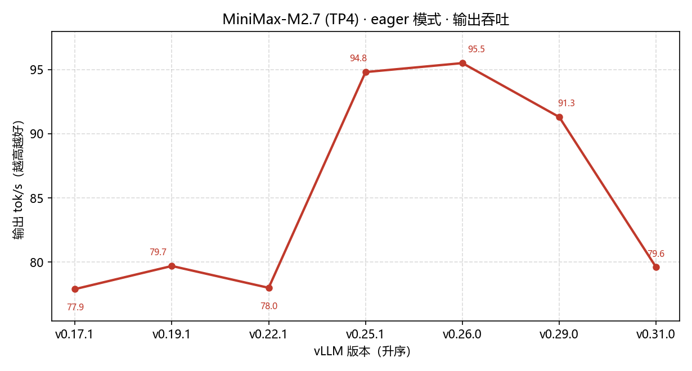
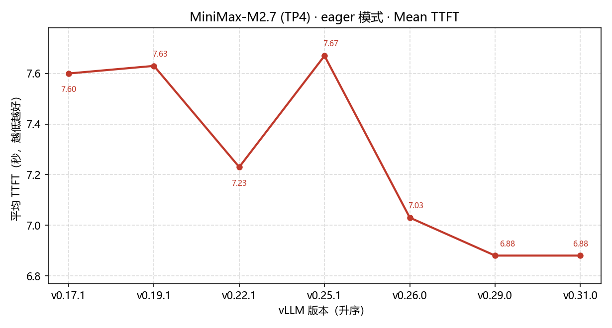
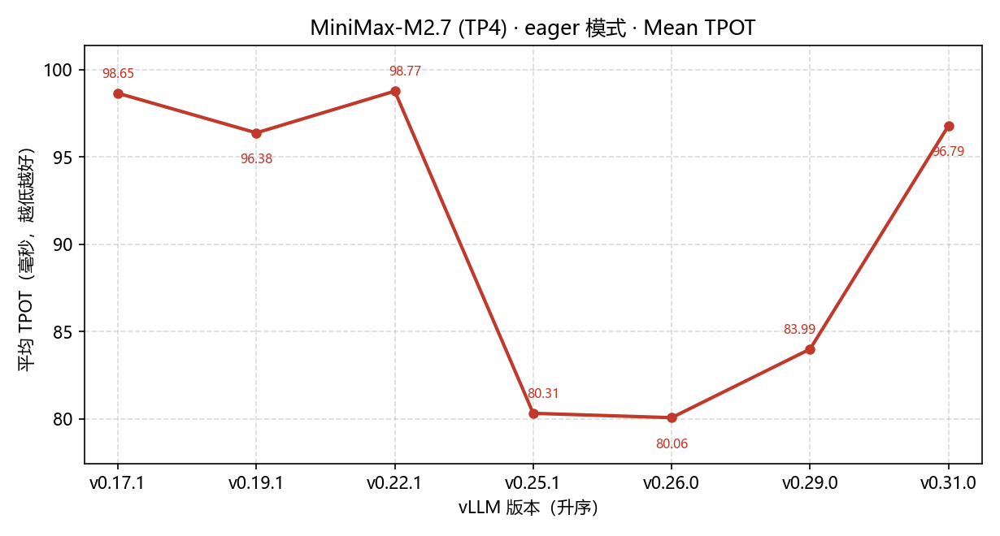
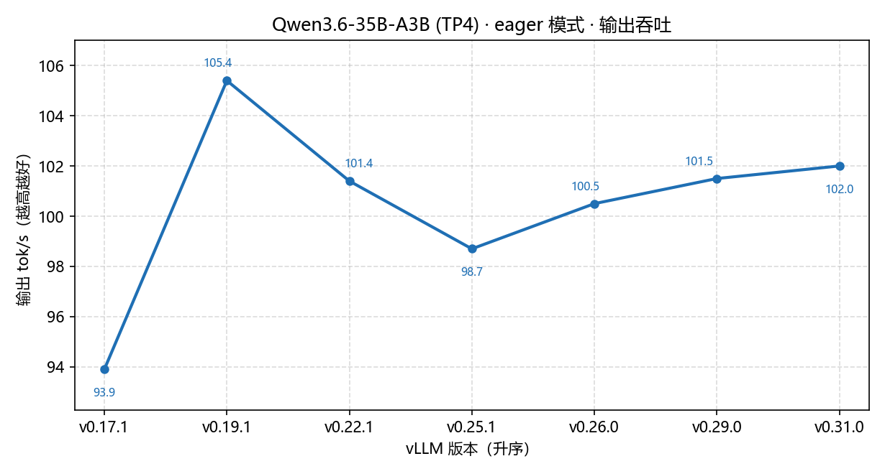
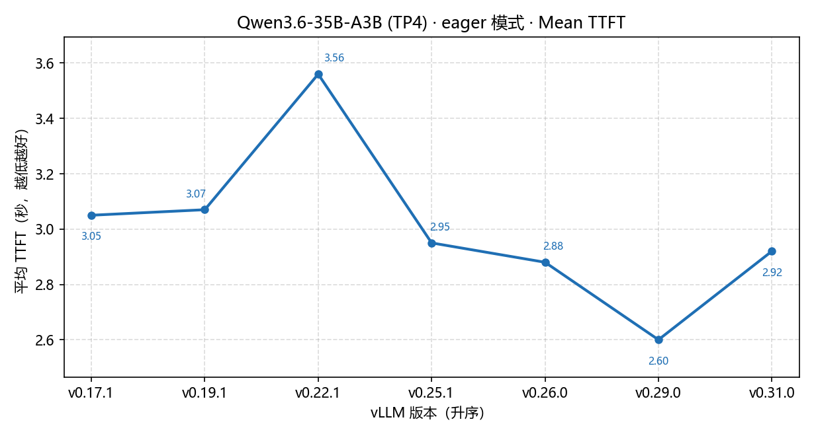
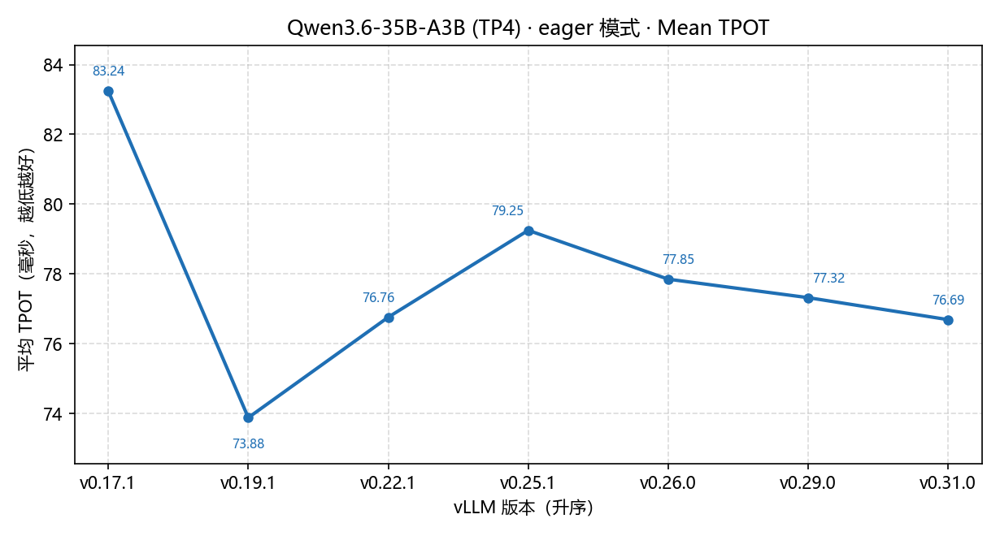

# vLLM 版本矩阵压测 · 结果汇总

> 数据生成时间：2026-10-22 01:30 UTC　｜　覆盖：4 个模型 × graph/eager 两种模式 × 7 个 vLLM 版本

生成时间：2026-10-22 01:22 UTC

## 目录

- [统一评测口径](#统一评测口径所有模型所有版本一致)
- [MiniMax-M2.7 · graph](#minimax-m27--graph)
- [MiniMax-M2.7 · eager](#minimax-m27--eager)
  - [版本趋势图](#版本趋势图v0171--v0310)
- [Qwen3.6-35B-A3B · graph](#qwen36-35b-a3b--graph)
- [Qwen3.6-35B-A3B · eager](#qwen36-35b-a3b--eager)
  - [版本趋势图](#版本趋势图v0171--v0310-1)
- [Qwen3.8-Flash-Next · graph](#qwen38-flash-next--graph)
- [Qwen3.8-Flash-Next · eager](#qwen38-flash-next--eager)
- [Qwen3.5-397B-A17B · graph](#qwen35-397b-a17b--graph)
- [MiniMax-M2.7 · recipe 负载 · graph](#minimax-m27--recipe-负载--graph)
- [MiniMax-M2.7 · recipe 负载 · eager](#minimax-m27--recipe-负载--eager)
- [MiniMax-M2.7 · recipe 负载 · 8 卡 · eager](#minimax-m27--recipe-负载--8-卡--eager)
- [完成度与还缺什么](#完成度与还缺什么)
- [已知环境限制](#已知环境限制详见-scriptsbenchenvironmentmd)
- [原始数据](#原始数据)

## 统一评测口径（所有模型、所有版本一致）

```
输入 65536 tokens / 输出 2048 tokens / 32 prompts / 并发 8
dataset random · endpoint /v1/completions · backend vllm · request_rate=inf
--gpu-memory-utilization 0.95 · --max-num-seqs 256 · --max-num-batched-tokens 8192
NCCL_NVLS_ENABLE=0（本机驱动不支持 NVLS 多播）· --disable-custom-all-reduce
```

同一模型内，7 个镜像版本的 CLI 参数 / 输入输出长度 / 并发数 **完全相同**；
TP 只在模型之间不同，由模型体积决定（M2.7 fp8 215G→TP4、Qwen3.6 67G→TP4、Qwen3.8 336G→TP4、Qwen3.5 752G→TP8）。

## MiniMax-M2.7 · graph

参数：TP4 · CUDA graph 开启

| 版本 | 状态 | req/s | 输出 tok/s | 总 tok/s | TTFT 均 | TTFT p99 | TPOT | 起服务 | 压测 |
|---|---|---|---|---|---|---|---|---|---|
| v0.31.0 | ✅ | 0.140 | 290.6 | 9589.5 | 10.26 s | 22.00 s | 22.49 ms | 342 s | 255 s |
| v0.29.0 | ✅ | 0.140 | 293.5 | 9686.6 | 10.47 s | 22.24 s | 22.12 ms | 343 s | 254 s |
| v0.26.0（eager） | ✅ | 0.050 | 96.5 | 3185.3 | 7.01 s | 22.93 s | 79.15 ms | 322 s | 710 s |
| v0.25.1（eager） | ✅ | 0.050 | 96.1 | 3169.8 | 7.61 s | 22.95 s | 79.26 ms | 161 s | 713 s |
| v0.22.1 | ✅ | 0.130 | 276.4 | 9120.6 | 10.40 s | 22.58 s | 23.81 ms | 353 s | 266 s |
| v0.19.1 | ✅ | 0.130 | 265.0 | 8745.9 | 11.00 s | 29.33 s | 24.75 ms | 443 s | 275 s |
| v0.17.1 | ✅ | 0.130 | 266.0 | 8778.3 | 11.04 s | 28.88 s | 24.65 ms | 453 s | 272 s |

## MiniMax-M2.7 · eager

参数：TP4 · --enforce-eager

| 版本 | 状态 | req/s | 输出 tok/s | 总 tok/s | TTFT 均 | TTFT p99 | TPOT | 起服务 | 压测 |
|---|---|---|---|---|---|---|---|---|---|
| v0.31.0 | ✅ | 0.040 | 79.6 | 2627.1 | 6.88 s | 23.37 s | 96.79 ms | 253 s | 853 s |
| v0.29.0 | ✅ | 0.040 | 91.3 | 3014.5 | 6.88 s | 22.91 s | 83.99 ms | 272 s | 749 s |
| v0.26.0 | ✅ | 0.050 | 95.5 | 3150.0 | 7.03 s | 22.95 s | 80.06 ms | 302 s | 718 s |
| v0.25.1 | ✅ | 0.050 | 94.8 | 3129.4 | 7.67 s | 22.95 s | 80.31 ms | 162 s | 721 s |
| v0.22.1 | ✅ | 0.040 | 78.0 | 2572.5 | 7.23 s | 24.18 s | 98.77 ms | 282 s | 870 s |
| v0.19.1 | ✅ | 0.040 | 79.7 | 2628.8 | 7.63 s | 30.87 s | 96.38 ms | 372 s | 850 s |
| v0.17.1 | ✅ | 0.040 | 77.9 | 2571.8 | 7.60 s | 30.67 s | 98.65 ms | 382 s | 866 s |

### 版本趋势图（v0.17.1 → v0.31.0）

**输出吞吐（tok/s，越高越好）**



**Mean TTFT（秒，越低越好）**



**Mean TPOT（毫秒，越低越好）**



版本要点：输出吞吐在 v0.25.1 / v0.26.0 出现台阶式跃升（78 → 95 tok/s），v0.31.0 回落到 79.6；
TTFT 随版本走高缓慢改善（7.60 s → 6.88 s）；TPOT 呈对称的 V 形——v0.25.1 / v0.26.0 最优（约 80 ms），
v0.29.0 / v0.31.0 回退到 84 / 97 ms。

## Qwen3.6-35B-A3B · graph

参数：TP4（bf16 67G）· CUDA graph 开启

| 版本 | 状态 | req/s | 输出 tok/s | 总 tok/s | TTFT 均 | TTFT p99 | TPOT | 起服务 | 压测 |
|---|---|---|---|---|---|---|---|---|---|
| v0.31.0 | ✅ | 0.420 | 867.8 | 28636.8 | 4.13 s | 7.36 s | 7.19 ms | 212 s | 104 s |
| v0.29.0 | ✅ | 0.430 | 880.2 | 29045.7 | 4.18 s | 7.67 s | 7.03 ms | 232 s | 105 s |
| v0.26.0 | ❌ startup_failed | — | — | — | — | — | — | — | — |
| v0.25.1 | ❌ startup_failed | — | — | — | — | — | — | — | — |
| v0.22.1 | ✅ | 0.350 | 719.7 | 23749.6 | 5.01 s | 9.96 s | 8.62 ms | 222 s | 119 s |
| v0.19.1 | ✅ | 0.330 | 675.9 | 22303.1 | 5.00 s | 15.60 s | 9.33 ms | 212 s | 125 s |
| v0.17.1 | ✅ | 0.330 | 672.8 | 22201.6 | 4.57 s | 15.20 s | 9.62 ms | 191 s | 124 s |

失败原因：
- `v0.26.0` → (Worker_TP0 pid=904) ERROR 10-21 19:48:52 [multiproc_executor.py:1007] RuntimeError: CUDA error: CUBLAS_STATUS_EXECUTION_FAILED when calling `cublasGemmEx( handle, opa, o
- `v0.25.1` → (Worker_TP1 pid=905) ERROR 10-21 20:29:55 [multiproc_executor.py:1004] torch.AcceleratorError: CUDA error: an illegal memory access was encountered

## Qwen3.6-35B-A3B · eager

参数：TP4（bf16 67G）· --enforce-eager

| 版本 | 状态 | req/s | 输出 tok/s | 总 tok/s | TTFT 均 | TTFT p99 | TPOT | 起服务 | 压测 |
|---|---|---|---|---|---|---|---|---|---|
| v0.31.0 | ✅ | 0.050 | 102.0 | 3366.3 | 2.92 s | 10.26 s | 76.69 ms | 131 s | 671 s |
| v0.29.0 | ✅ | 0.050 | 101.5 | 3349.2 | 2.60 s | 8.70 s | 77.32 ms | 162 s | 676 s |
| v0.26.0 | ✅ | 0.050 | 100.5 | 3316.1 | 2.88 s | 10.48 s | 77.85 ms | 191 s | 682 s |
| v0.25.1 | ✅ | 0.050 | 98.7 | 3257.3 | 2.95 s | 10.73 s | 79.25 ms | 161 s | 694 s |
| v0.22.1 | ✅ | 0.050 | 101.4 | 3345.5 | 3.56 s | 13.32 s | 76.76 ms | 142 s | 674 s |
| v0.19.1 | ✅ | 0.050 | 105.4 | 3476.9 | 3.07 s | 16.44 s | 73.88 ms | 131 s | 649 s |
| v0.17.1 | ✅ | 0.050 | 93.9 | 3099.1 | 3.05 s | 16.23 s | 83.24 ms | 141 s | 724 s |

### 版本趋势图（v0.17.1 → v0.31.0）

**输出吞吐（tok/s，越高越好）**



**Mean TTFT（秒，越低越好）**



**Mean TPOT（毫秒，越低越好）**



版本要点：输出吞吐全程 94–105 tok/s，best 在 v0.19.1（105.4）；TTFT 2.60–3.56 s，v0.29.0 最低；
TPOT 73.9–83.2 ms，v0.19.1 最优，版本间差异明显小于 M2.7。

## Qwen3.8-Flash-Next · graph

参数：TP4（bf16 336G）· CUDA graph 开启

| 版本 | 状态 | req/s | 输出 tok/s | 总 tok/s | TTFT 均 | TTFT p99 | TPOT | 起服务 | 压测 |
|---|---|---|---|---|---|---|---|---|---|
| v0.31.0 | ✅ | 0.250 | 515.7 | 17018.1 | 7.17 s | 14.73 s | 11.99 ms | 353 s | 156 s |
| v0.29.0 | ✅ | 0.220 | 449.2 | 14824.1 | 8.89 s | 21.46 s | 13.45 ms | 292 s | 176 s |
| v0.26.0 | ❌ startup_failed | — | — | — | — | — | — | — | — |
| v0.25.1 | ❌ startup_failed | — | — | — | — | — | — | — | — |
| v0.22.1 | ❌ startup_failed | — | — | — | — | — | — | — | — |
| v0.19.1 | ❌ startup_failed | — | — | — | — | — | — | — | — |
| v0.17.1 | ❌ startup_failed | — | — | — | — | — | — | — | — |

失败原因：
- `v0.26.0` → (APIServer pid=1)   Value error, The checkpoint you are trying to load has model type `qwen4_exp` but Transformers does not recognize this architecture. This could be bec
- `v0.25.1` → (APIServer pid=1)   Value error, The checkpoint you are trying to load has model type `qwen4_exp` but Transformers does not recognize this architecture. This could be bec
- `v0.22.1` → (APIServer pid=1)   Value error, The checkpoint you are trying to load has model type `qwen4_exp` but Transformers does not recognize this architecture. This could be bec
- `v0.19.1` → (APIServer pid=1)   Value error, The checkpoint you are trying to load has model type `qwen4_exp` but Transformers does not recognize this architecture. This could be bec
- `v0.17.1` → (APIServer pid=1)   Value error, The checkpoint you are trying to load has model type `qwen4_exp` but Transformers does not recognize this architecture. This could be bec

## Qwen3.8-Flash-Next · eager

参数：TP4（bf16 336G）· --enforce-eager

| 版本 | 状态 | req/s | 输出 tok/s | 总 tok/s | TTFT 均 | TTFT p99 | TPOT | 起服务 | 压测 |
|---|---|---|---|---|---|---|---|---|---|
| v0.31.0 | ✅ | 0.030 | 71.1 | 2347.7 | 5.17 s | 19.82 s | 109.36 ms | 212 s | 951 s |
| v0.29.0 | ✅ | 0.040 | 72.5 | 2392.3 | 5.96 s | 22.88 s | 107.14 ms | 202 s | 934 s |
| v0.26.0 | ❌ startup_failed | — | — | — | — | — | — | — | — |
| v0.25.1 | ❌ startup_failed | — | — | — | — | — | — | — | — |
| v0.22.1 | ❌ startup_failed | — | — | — | — | — | — | — | — |
| v0.19.1 | ❌ startup_failed | — | — | — | — | — | — | — | — |
| v0.17.1 | ❌ startup_failed | — | — | — | — | — | — | — | — |

失败原因：
- `v0.26.0` → (APIServer pid=1)   Value error, The checkpoint you are trying to load has model type `qwen4_exp` but Transformers does not recognize this architecture. This could be bec
- `v0.25.1` → (APIServer pid=1)   Value error, The checkpoint you are trying to load has model type `qwen4_exp` but Transformers does not recognize this architecture. This could be bec
- `v0.22.1` → (APIServer pid=1)   Value error, The checkpoint you are trying to load has model type `qwen4_exp` but Transformers does not recognize this architecture. This could be bec
- `v0.19.1` → (APIServer pid=1)   Value error, The checkpoint you are trying to load has model type `qwen4_exp` but Transformers does not recognize this architecture. This could be bec
- `v0.17.1` → (APIServer pid=1)   Value error, The checkpoint you are trying to load has model type `qwen4_exp` but Transformers does not recognize this architecture. This could be bec

## Qwen3.5-397B-A17B · graph

参数：TP8（bf16 752G，必须占满 8 卡）· CUDA graph 开启

| 版本 | 状态 | req/s | 输出 tok/s | 总 tok/s | TTFT 均 | TTFT p99 | TPOT | 起服务 | 压测 |
|---|---|---|---|---|---|---|---|---|---|
| v0.31.0 | ✅ | 0.210 | 434.5 | 14338.3 | 7.36 s | 15.06 s | 14.79 ms | 1207 s | 180 s |
| v0.29.0 | ✅ | 0.220 | 440.9 | 14549.0 | 7.63 s | 15.25 s | 14.40 ms | 352 s | 179 s |
| v0.26.0 | ❌ startup_failed | — | — | — | — | — | — | — | — |
| v0.25.1 | ❌ startup_failed | — | — | — | — | — | — | — | — |

失败原因：
- `v0.26.0` → (Worker_TP3 pid=907) ERROR 10-21 23:56:23 [multiproc_executor.py:1007] RuntimeError: CUDA error: CUBLAS_STATUS_EXECUTION_FAILED when calling `cublasGemmEx( handle, opa, o
- `v0.25.1` → 按用户要求中止评测（397B 单版加载 6~20 分钟，时间成本过高）

## MiniMax-M2.7 · recipe 负载 · graph

参数：TP4 · graph · 2048 in / 1024 out / 并发 10 / 100 prompts

| 版本 | 状态 | req/s | 输出 tok/s | 总 tok/s | TTFT 均 | TTFT p99 | TPOT | 起服务 | 压测 |
|---|---|---|---|---|---|---|---|---|---|
| v0.31.0 | ✅ | 0.880 | 902.4 | 2707.1 | 0.37 s | 1.54 s | 10.73 ms | 342 s | 127 s |
| v0.29.0 | ✅ | 0.920 | 938.8 | 2816.3 | 0.50 s | 1.55 s | 10.17 ms | 343 s | 124 s |
| v0.26.0 | ❌ startup_failed | — | — | — | — | — | — | — | — |

失败原因：
- `v0.26.0` → (Worker_TP0 pid=953) ERROR 10-22 01:07:39 [multiproc_executor.py:1007] RuntimeError: CUDA driver error (/workspace/.deps/deepgemm-src/csrc/apis/../jit_kernels/impls/../..

## MiniMax-M2.7 · recipe 负载 · eager

参数：TP4 · --enforce-eager · 同上负载

> 未运行（时间成本过高，按要求停止）。

## MiniMax-M2.7 · recipe 负载 · 8 卡 · eager

参数：TP8 + --enable-expert-parallel + --enforce-eager · 同上负载

> 未运行（时间成本过高，按要求停止）。

## 完成度与还缺什么

| 模型 | 模式 | 完成 | 缺失 |
|---|---|---|---|
| MiniMax-M2.7 | graph | 7/7 | 无（0.25/0.26 只能用 eager，已在 graph 表内标注 TP4+eager） |
| MiniMax-M2.7 | eager | 7/7 | 无 |
| Qwen3.6-35B-A3B | graph | 5/7 | v0.26.0 / v0.25.1（CUDA graph 捕获缺陷，无法开启 graph） |
| Qwen3.6-35B-A3B | eager | 7/7 | 无 |
| Qwen3.8-Flash-Next | graph | 2/7 | v0.26.0 及更早 5 个版本不识别 Qwen4Exp 架构，无法加载 |
| Qwen3.8-Flash-Next | eager | 2/7 | 同上 5 个版本架构不支持 |
| Qwen3.5-397B-A17B | graph | 2/4 | v0.22.1 / v0.19.1 / v0.17.1 未跑（时间成本，已停止）；v0.25.1 中途停止 |
| MiniMax-M2.7 · recipe 负载 | graph | 2/3 | v0.25.1 / v0.22.1 / v0.19.1 / v0.17.1 被外部占卡打断（非版本问题，可补跑）；v0.26.0 图捕获崩溃 |
| MiniMax-M2.7 · recipe 负载 | eager | 未运行 | 整轮 7 版未跑 |
| MiniMax-M2.7 · recipe 负载 · 8 卡 | eager | 未运行 | 整轮 7 版未跑 |

## 已知环境限制（详见 scripts/bench/ENVIRONMENT.md）

1. **NVLS 多播不可用**：驱动 595.45.04 + 本机 NVSwitch 下 `init_multicast_for_block` 被拒；统一 `NCCL_NVLS_ENABLE=0`。
2. **0.25/0.26 的 CUDA graph 捕获会崩**（`illegal memory access`）；只有 `--enforce-eager` 能起，这也是全平台切 eager 的原因。
3. **纯 TP8 对 fp8 分块量化的 M2.7 不成立**（1536/8=192 不整除 128），必须 TP4。
4. **Qwen3.8-Flash 的 Qwen4Exp 架构**只有 0.29/0.31 认识。

## 原始数据

```
/data/liuxin/bifrost/bench/<模型>-<模式>/
  summary.tsv           汇总表
  REPORT.md             本目录的单独报告
  v<版本>/result.json   vLLM bench 原始输出
  v<版本>/serve.log     服务端日志
```

