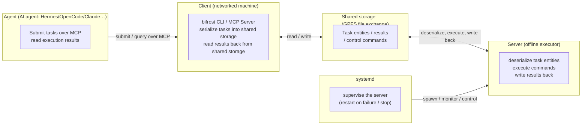
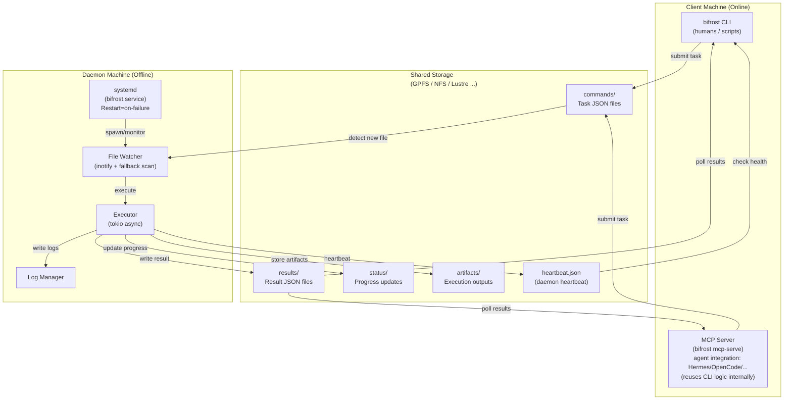
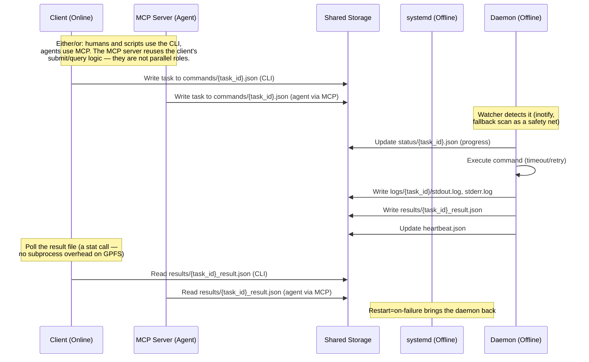

# Architecture and Internals

Design-level material for Bifrost. The [README](../../README.md) is the user guide; this document
covers components, the task lifecycle, the shared-storage layout, security boundaries, and the
source tree.

> [简体中文](architecture.zh-CN.md) | English

## Components

### Simplified (four components)



### Detailed (shared storage and daemon internals)



## Task lifecycle



## Shared-storage layout

```
/shared/storage/
├── commands/              # Client writes, daemon reads
│   └── 20260704_103000_{uuid}.json
├── results/               # Daemon writes, client reads
│   └── {uuid}_result.json
├── status/                # Daemon writes progress updates
│   └── {uuid}.json
├── artifacts/             # Execution artifacts
│   └── {uuid}_report.json
├── logs/                  # Detailed execution logs
│   └── {uuid}/
│       ├── stdout.log
│       ├── stderr.log
│       └── metadata.json
├── heartbeat.json         # Daemon health status
└── .processing/           # In-flight claim markers (stale ones are reclaimed)
```

## Design decisions

| Decision | Why |
|---|---|
| **Shared storage instead of a database queue** | The two sides never share a network, and a POSIX directory is the only channel both can use. Files are easy to inspect and a corrupt file only affects one task. |
| **Event-driven inotify plus a fallback scan** | inotify gives millisecond latency; idle cost is one 1s fallback `read_dir`, not a high-frequency poll. Network filesystems can drop events, so the scan covers them. `scan_mode=auto` only switches to busy-poll when the clock is proven broken. |
| **Rust single binary** | No runtime or package dependencies on the offline machine, predictable latency (no GC pauses), and a static musl build that runs anywhere on x86_64 Linux. |
| **Bridge trait** | `shared` and `ssh` transports expose the same directory semantics, so the daemon does not change when the client talks over SSH. |
| **Opt-in retries** | A task runs once unless it asks for retries; only non-zero exits are retried, never timeouts or cancellations. |

## Security model

### Command execution

`daemon.use_shell` defaults to `true`: commands run as `sh -c "<command>"`, so pipes, redirects,
`&&`, `$VAR` and background `&` work. This is a deliberate trust boundary — whoever can write to
`commands/` can already run code, and the daemon does not try to sanitize shell syntax.

With `use_shell: false` (daemon-wide) or `shell: false` (per task), the command is parsed with
`shell-words::split()` and executed as argv, without shell interpolation:

```rust
let args = shell_words::split(&command)?;
Command::new(&args[0]).args(&args[1..]);
```

Use the argv mode for tasks whose arguments contain literal `$`, `*` or quotes:

```bash
# shell off: the regex is passed through literally
bifrost client submit --command "grep -n 'a.*b' file.txt"   # with shell: false in the task
```

### Task monitoring: event-driven with a fallback scan

The daemon does **not** continuously poll `commands/`. It combines three mechanisms:

| Mechanism | What happens |
|---|---|
| **Event-driven fast path** | `notify` registers an inotify watch on `commands/`. When a client creates or renames a `.json` task into the directory, the kernel pushes an event and the watcher forwards the path to the runner. No directory listing happens on this path. A 500ms per-path debounce suppresses duplicate events for the same file. |
| **Fallback scan (1s default)** | A dedicated thread wakes every `daemon.scan_interval` and performs one `read_dir`. It covers filesystems that drop inotify events (GPFS/NFS), watcher restarts, and events the fast path missed. If every execution slot is busy, the scan is skipped. |
| **Startup catch-up** | Before entering the main loop the daemon scans `commands/` once, so tasks submitted while it was down are not lost. |

Both the event path and the scan submit through the same `spawn_task`; an atomic `.processing`
marker (`create_new`) guarantees a task seen by both paths executes only once. A separate thread
stats stale markers every 10s and reclaims them.

**What is a timed wakeup, and what is polling?**

- The runner waits on the watcher channel with a 500ms timeout solely to notice shutdown; an event
  returns immediately.
- The watcher thread uses a 100ms `recv_timeout` on the inotify channel — a blocking wait with a
  timeout, not a directory scan.
- In normal mode the only periodic directory work is the 1s fallback `read_dir`; the scan thread
  sleeps between ticks. Idle cost is therefore a 1s scan, a 10s marker stat, and timer wakeups —
  not a high-frequency poll.

**Latency:** the event path is milliseconds; the worst case when an event is lost is one fallback
interval (1s by default).

**`scan_mode` and the one busy-poll case:**

| scan_mode | Behaviour |
|---|---|
| `auto` (default) | ~100ms clock probe at startup; stays sleep-driven unless the monotonic clock is frozen |
| `sleep` | always timer-driven (lowest CPU) |
| `spin` | busy-poll (~1 core) for hosts whose `CLOCK_MONOTONIC` is frozen |

`spin` exists because `sleep()` deadlines never fire on those hosts; it is not the default.

If tasks still look stuck, check that `shared_storage` resolves to the same physical directory on
both machines and that `scan.json` is fresh.

### Path traversal protection

Artifact paths are validated with canonicalization:

```rust
// Validate: no /, \, .., or null bytes
// Canonicalize: verify path is within artifacts directory
let canonical = artifact_path.canonicalize()?;
if !canonical.starts_with(&artifacts_dir) {
    return Err("Path traversal detected");
}
```

## Source layout

```
bifrost/
├── src/
│   ├── core/           # Core models, protocol, and services
│   │   ├── models.rs   # Task, TaskResult, TaskStatus
│   │   ├── bridge.rs   # Bridge transport trait
│   │   ├── protocol.rs # Shared-storage bridge impl
│   │   ├── settings.rs # ~/.bifrost/settings.json
│   │   ├── sdnotify.rs # systemd readiness notification
│   │   ├── error.rs    # Error types
│   │   ├── lock.rs     # File locking
│   │   └── batch_tracker.rs
│   ├── client/         # Client submission and query
│   │   ├── submit.rs   # Task submission
│   │   ├── status.rs   # Status query
│   │   ├── results.rs  # Result retrieval
│   │   └── launcher.rs # Job launcher
│   ├── daemon/         # Daemon executor and watcher
│   │   ├── watcher.rs  # File event monitoring
│   │   ├── executor.rs # Command execution
│   │   ├── heartbeat.rs# Health monitoring
│   │   └── logger.rs   # Log management
│   └── main.rs         # CLI entry point
├── tests/
│   ├── unit/           # Unit tests
│   └── integration/    # Integration tests
├── config/             # Default configurations
├── scripts/            # Build / deploy / validation scripts
└── docs/               # Documentation
```

## Further reading

- [README](../../README.md) — install, configure, and use Bifrost
- [Advanced usage](advanced_usage.md) — full settings reference, SSH bridge, task scheduling, MCP agent configs
- [Deployment guide](../deployment.md) — production deployment and systemd
- [Adapter guide](../adapter-guide.md) — custom task adapters
- [Operations practice](../ops-practice.md) — operational notes
