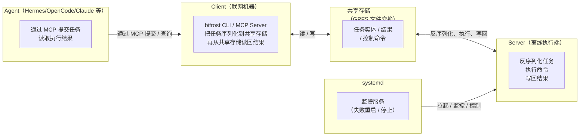
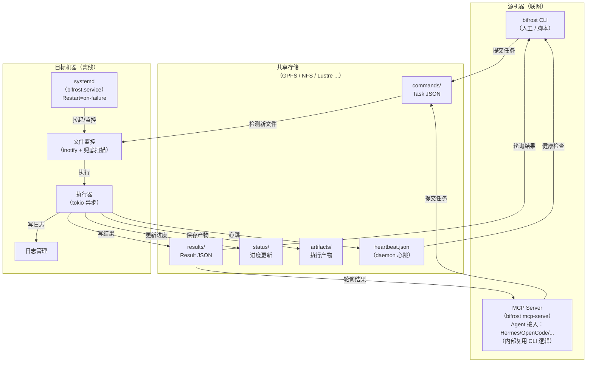
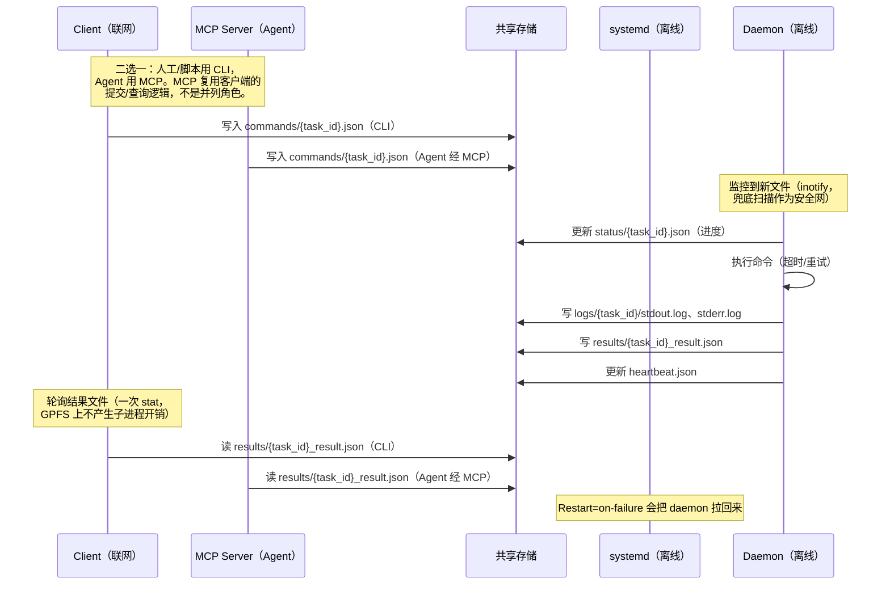

# 架构与内部实现

面向开发者的设计文档。用户安装与使用请看 [README](../../README.zh-CN.md)；本文覆盖组件、
任务生命周期、共享存储布局、安全边界与源码结构。

> [English](architecture.md) | 简体中文

## 组件

### 简略图（四组件交互）



### 详细图（含共享存储与内部组件）



## 任务生命周期



## 共享存储布局

```
/shared/storage/
├── commands/              # 客户端写，daemon 读
│   └── 20260704_103000_{uuid}.json
├── results/               # daemon 写，客户端读
│   └── {uuid}_result.json
├── status/                # daemon 写进度
│   └── {uuid}.json
├── artifacts/             # 执行产物
│   └── {uuid}_report.json
├── logs/                  # 详细执行日志
│   └── {uuid}/
│       ├── stdout.log
│       ├── stderr.log
│       └── metadata.json
├── heartbeat.json         # daemon 健康状态
└── .processing/           # 执行中的 claim 标记（过期会被回收）
```

## 设计取舍

| 决策 | 原因 |
|---|---|
| **用共享存储而不是数据库队列** | 两侧没有网络，POSIX 目录是双方都能用的唯一通道。文件易检查，损坏只影响单个任务。 |
| **事件驱动 inotify + 兜底扫描** | inotify 提供毫秒级延迟；空闲成本只是一次/秒的兜底 `read_dir`，不是高频轮询。网络文件系统可能丢事件，因此加周期性扫描。`scan_mode=auto` 只在时钟确实异常时才切到忙轮询。 |
| **Rust 单二进制** | 目标机不需要运行时和依赖，延迟可预测（无 GC 停顿），静态 musl 构建可在任意 x86_64 Linux 运行。 |
| **Bridge trait** | `shared` 与 `ssh` 暴露相同的目录语义，客户端改用 SSH 时 daemon 无需修改。 |
| **重试按任务显式开启** | 默认只跑一次；只有非零退出才重试，超时和取消不重试。 |

## 安全模型

### 命令执行

`daemon.use_shell` 默认是 `true`：命令以 `sh -c "<command>"` 执行，因此管道、重定向、`&&`、
`$VAR` 和后台 `&` 都可直接使用。这是有意设计的信任边界——能写 `commands/` 的人本来就能执行
代码，daemon 不会尝试清洗 shell 语法。

当 `use_shell: false`（daemon 级）或 `shell: false`（单任务）时，命令用
`shell-words::split()` 解析成 argv 直接执行，不做 shell 插值：

```rust
let args = shell_words::split(&command)?;
Command::new(&args[0]).args(&args[1..]);
```

参数包含字面量 `$`、`*` 或引号时使用这种模式：

```bash
# 关闭 shell：正则按字面量传递
bifrost client submit --command "grep -n 'a.*b' file.txt"   # 任务里带 shell: false
```

### 任务监听：事件驱动 + 兜底扫描

daemon **不会**持续轮询 `commands/`，而是三层机制组合：

| 机制 | 行为 |
|---|---|
| **事件驱动快路径** | `notify` 在 `commands/` 上注册 inotify 监听。客户端创建/重命名 `.json` 任务文件时，内核推送事件，watcher 立即把路径交给 runner。这条路径**不做目录遍历**；同一文件 500ms 内的重复事件会被去重。 |
| **兜底扫描（默认 1s）** | 独立线程每隔 `daemon.scan_interval` 醒来一次，执行一次 `read_dir`。用于覆盖会丢 inotify 事件的文件系统（GPFS/NFS）、watcher 重启以及快路径漏掉的事件。所有执行槽都忙时跳过扫描。 |
| **启动 catch-up** | 进入主循环前先扫一遍 `commands/`，daemon 停机期间提交的任务不会丢。 |

事件路径和兜底扫描最终都走同一个 `spawn_task`；原子 `.processing` 标记（`create_new`）保证
同一任务被两条路径同时看到时也只执行一次。另有独立线程每 10s stat 一次过期标记并回收。

**哪些是定时唤醒，哪些是轮询？**

- runner 在 watcher channel 上带 500ms 超时等待，只是为了能及时检查 shutdown；有事件会立即返回。
- watcher 线程对 inotify 事件通道使用 100ms `recv_timeout`——这是带超时的阻塞等待，不是目录扫描。
- 正常模式下唯一的周期性目录操作是 1s 一次的兜底 `read_dir`；扫描线程在两次 tick 之间 sleep。
  因此空闲成本是：1s 扫描 + 10s 标记检查 + 定时唤醒，而不是高频轮询。

**延迟：** 事件路径为毫秒级；事件丢失时的最坏情况是一个兜底周期（默认 1s）。

**`scan_mode` 与唯一的忙轮询场景：**

| scan_mode | 行为 |
|---|---|
| `auto`（默认） | 启动时约 100ms 时钟探测；只要单调时钟正常就保持 sleep 驱动 |
| `sleep` | 始终定时器驱动（CPU 最低） |
| `spin` | 忙轮询（约 1 核），只用于 `CLOCK_MONOTONIC` 冻结的宿主 |

`spin` 存在的原因是那些宿主上 `sleep()` deadline 永远不会到达；它不是默认值。

如果任务仍像卡住，检查两端 `shared_storage` 是否指向**同一个物理目录**，以及 `scan.json`
是否在更新。

### 防路径穿越

artifact 路径会做规范化校验：

```rust
// 校验：不含 /、\、.. 或空字节
// 规范化后确认路径仍在 artifacts 目录内
let canonical = artifact_path.canonicalize()?;
if !canonical.starts_with(&artifacts_dir) {
    return Err("Path traversal detected");
}
```

## 源码结构

```
bifrost/
├── src/
│   ├── core/           # 核心模型、协议与服务
│   │   ├── models.rs   # Task、TaskResult、TaskStatus
│   │   ├── bridge.rs   # Bridge 传输 trait
│   │   ├── protocol.rs # 共享存储 Bridge 实现
│   │   ├── settings.rs # ~/.bifrost/settings.json
│   │   ├── sdnotify.rs # systemd 就绪通知
│   │   ├── error.rs    # 错误类型
│   │   ├── lock.rs     # 文件锁
│   │   └── batch_tracker.rs
│   ├── client/         # 客户端提交与查询
│   │   ├── submit.rs   # 任务提交
│   │   ├── status.rs   # 状态查询
│   │   ├── results.rs  # 结果读取
│   │   └── launcher.rs # Job 执行器
│   ├── daemon/         # daemon 执行器与监控
│   │   ├── watcher.rs  # 文件事件监控
│   │   ├── executor.rs # 命令执行
│   │   ├── heartbeat.rs# 健康监控
│   │   └── logger.rs   # 日志管理
│   └── main.rs         # CLI 入口
├── tests/
│   ├── unit/           # 单元测试
│   └── integration/    # 集成测试
├── config/             # 默认配置
├── scripts/            # 构建 / 部署 / 校验脚本
└── docs/               # 文档
```

## 延伸阅读

- [README](../../README.zh-CN.md) — 安装、配置与使用
- [高级用法](advanced_usage.zh-CN.md) — 完整配置参考、SSH 传输、任务调度、MCP Agent 配置
- [部署指南](../deployment.zh-CN.md) — 生产部署与 systemd
- [适配器指南](../adapter-guide.md) — 自定义任务适配器
- [运维实践](../ops-practice.md) — 实际运维记录
